# CSS:

The cascade algorithm is split into 4 distinct stages.

Position and order of appearance: the order of which your CSS rules appear
Specificity: an algorithm which determines which CSS selector has the strongest match
Origin: the order of when CSS appears and where it comes from, whether that is a browser style, CSS from a browser extension, or your authored CSS
Importance: some CSS rules are weighted more heavily than others, especially with the !important rule type

## specificity:

Universal selector #
- A universal selector (*) has no specificity and gets 0 points.

- An element (type) or pseudo-element selector gets 1 point of specificity .

Class, pseudo-class, or attribute selector #
- A class, pseudo-class or attribute selector gets 10 points of specificity.

ID selector #
- An ID selector gets 100 points of specificity, as long as you use an ID selector (#myID) and not an attribute selector ([id="myID"]).

Inline style attribute #
CSS applied directly to the style attribute of the HTML element, gets a specificity score of 1,000 points. 

!important rule #
Lastly, an !important at the end of a CSS value gets a specificity score of 10,000 points.

## css background:

### background-image properties:

- By default, the background-image property repeats an image both horizontally and vertically.
- `background-repeat: repeat-x;` : repeated only horizontally
- `background-repeat: repeat-y;` : repeat an image vertically
- `background-repeat: no-repeat;` : no reapeat background

### CSS background-position

- The background-position property is used to specify the position of the background image.
- `background-position` property is used.

### CSS background-attachment:

- The `background-attachment` property specifies whether the background image should scroll or be fixed.
- Values are : `fixed`, `scroll`

### CSS background - Shorthand property:

- To shorten the code, it is also possible to specify all the background properties in one single property.
- Example: `body { background: #ffffff url("img_tree.png") no-repeat right top; }`

## css border:

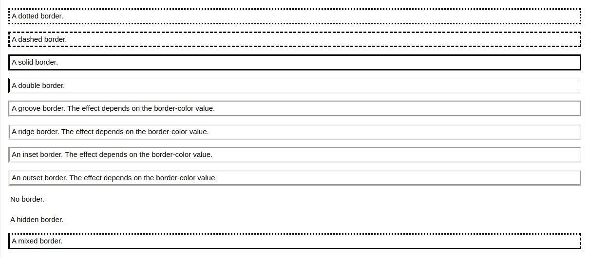  

`Properties`:-

- `border-width`, `border-color`,`border-sides`, `border-radius` etc.
- In CSS, there are also properties for specifying each of the borders (top, right, bottom, and left).
- `border-side_name-style`. you can write like this : `border-style: dotted solid double dashed;`

## CSS Margins:

- The CSS `margin` properties are used to create space around elements, outside of any defined borders.
- `margin` will be `possible` in `minus` value.

### margin : `auto`:

- horizontally center the element within its container.

### inherit Value:

- current element be inherited the margin property from the parent element.

### Margin Collapse:

- Top and bottom margins of elements are sometimes collapsed into a single margin that is equal to the largest of the two margins.
- This does not happen on left and right margins! Only top and bottom margins!

## CSS padding:

- Padding is used to create space around an element's content, inside of any defined borders.
- length - specifies a padding in px, pt, cm, etc.
- `%` : specifies a padding in % of the width of the containing element
- `inherit` : specifies that the padding should be inherited from the parent element
- Note: Negative values are not allowed.

## CSS Height, Width and Max-width:

- The CSS height and width properties are used to set the `height` and `width` of an `element`. The CSS `max-width` property is used to set the maximum width of an element.

### height and width Values:

- auto - This is default. The browser calculates the height and width
- length - Defines the height/width in px, cm, etc.
- % - Defines the height/width in percent of the containing block
- initial - Sets the height/width to its default value
- inherit - The height/width will be inherited from its parent value

## Box Model:

- Content - The content of the box, where text and images appear
- Padding - Clears an area around the content. The padding is transparent
- Border - A border that goes around the padding and content
- Margin - Clears an area outside the border. The margin is transparent

## Border Box:

- In the border box model, the width and height of an element include its content, padding, and border. This means that the specified width and height values include the space taken up by the content, padding, and border combined.

- Width = content width + padding + border
- Height = content height + padding + border

## Content Box:

- In the content box model, the width and height of an element are calculated based on the content's dimensions alone, excluding padding, border, and margin. In other words, the content box represents the innermost dimensions of an element that holds its actual content.

- Width = content width
- Height = content height

## CSS Outline:

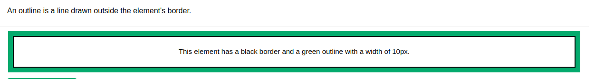

## css text:

### Text Alignment:

- The text-align property is used to set the horizontal alignment of a text.
- A text can be `left` or `right` aligned, `centered`, or `justified`.
- When the text-align property is set to `"justify"`, each line is stretched so that every line has equal width, and the left and right margins are straight

### `text-align-last`:

- The `text-align-last` property specifies how to align the last line of a text.

### Text Direction

- The direction and unicode-bidi properties can be used to change the text direction of an element:

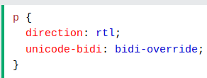

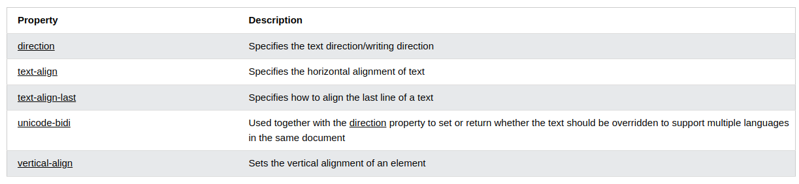

### Text Decoration:

- All links in HTML are underlined by default. Sometimes you see that links are styled with no underline. The `text-decoration: none;` is used to remove the underline from links, like this.

### Text Spacing:

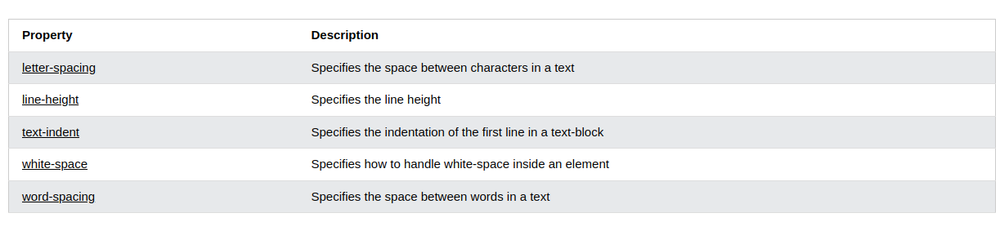

### Text Shadow:

- `h1 {
  text-shadow: 2px 2px 5px red;
}`
- 5px specify the blure shadow.

## What are Web Safe Fonts?

- Web safe fonts are fonts that are universally installed across all browsers and devices.

## Max-width:

- only width will add scrollbar when the screen is getting small after that width where max width will sync with screen.

## css display:

- display: `inline` -> it will take the space as it's size is there.
- `block` -> we can set width of block element.
- `inline-block` :means in one line it will apear and we can set height and width of it.

## CSS Position:

- properties: `static(default),absolute,relative, fixed, sticky(top:0)`

## CSS Combinators:

- descendant selector (space)
- child selector (>)
- adjacent sibling selector (+)
- general sibling selector (~)

### Descendant Selector:

- The following example selects all `
` elements inside `
` elements:  
  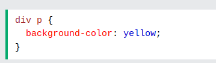

### Child Selector (>):

- The child selector selects all elements that are the children of a specified element. 
  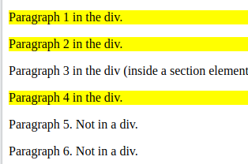

### Adjacent Sibling Selector (+):

- "adjacent" means "immediately following".
- The following example selects the first `
` element that are placed immediately after `
` elements.

### General Sibling Selector (~):

- selects all elements that are next siblings of a specified element.

## What are Pseudo-classes?

- A pseudo-class is used to define a special state of an element.

### Hover on `
`:

- `:hover` pseudo-class
- `:first-child` Pseudo-class :- pseudo-class matches a specified element that is the first child of another element.

## What are Pseudo-Elements?

- A CSS pseudo-element is used to style specified parts of an element.
- For example, it can be used to:
  - Style the first letter, or line, of an element
  - Insert content before, or after, the content of an element

## Units:

- 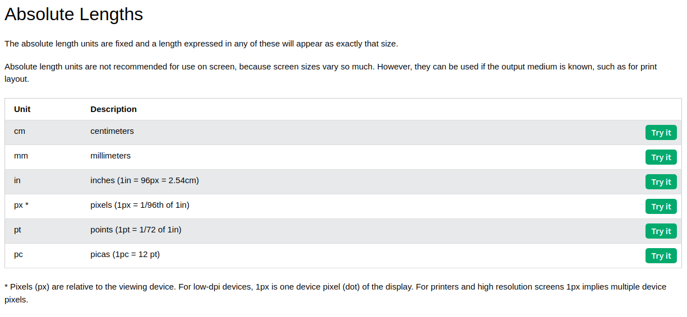 

- 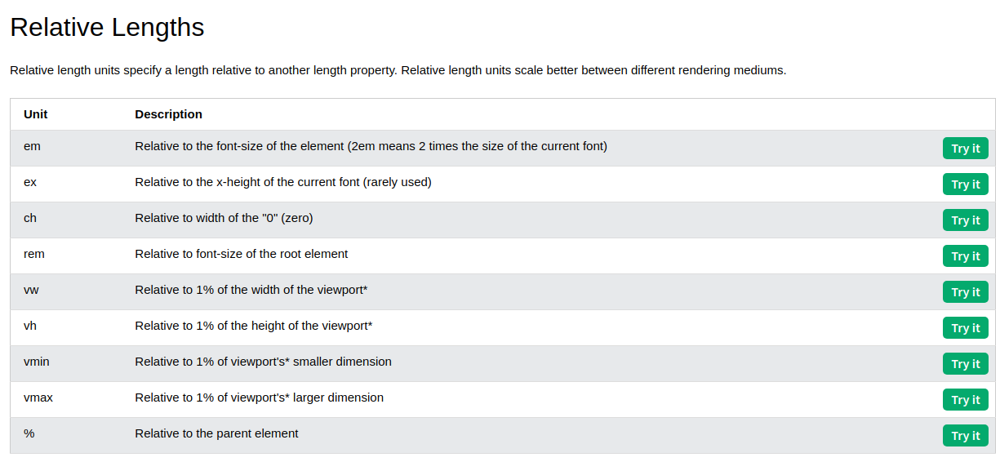

## What is Specificity?

- If there are two or more CSS rules that point to the same element, the selector with the highest specificity value will "win", and its style declaration will be applied to that HTML element.

- 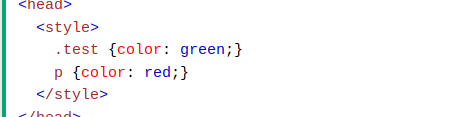

## What is !important?

- The !important rule in CSS is used to add more importance to a property/value than normal.

## CSS Variables:

- The var() function is used to insert the value of a CSS variable.
- The syntax of the var() function is as follows:
  `var(--name, value)`  

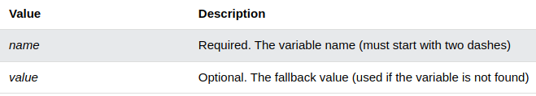

## Media quries:

- Syntax:  
  `@media not|only mediatype and (expressions) {
  CSS-Code;
}`

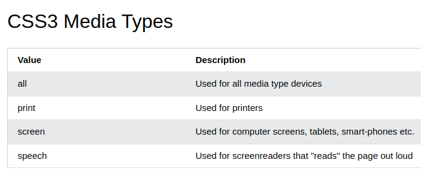
