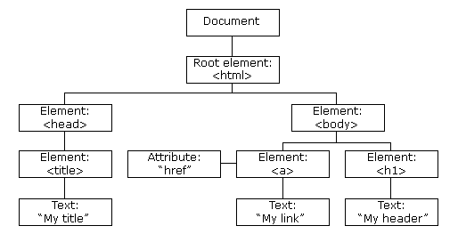
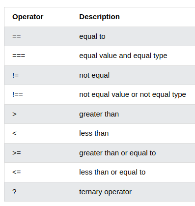
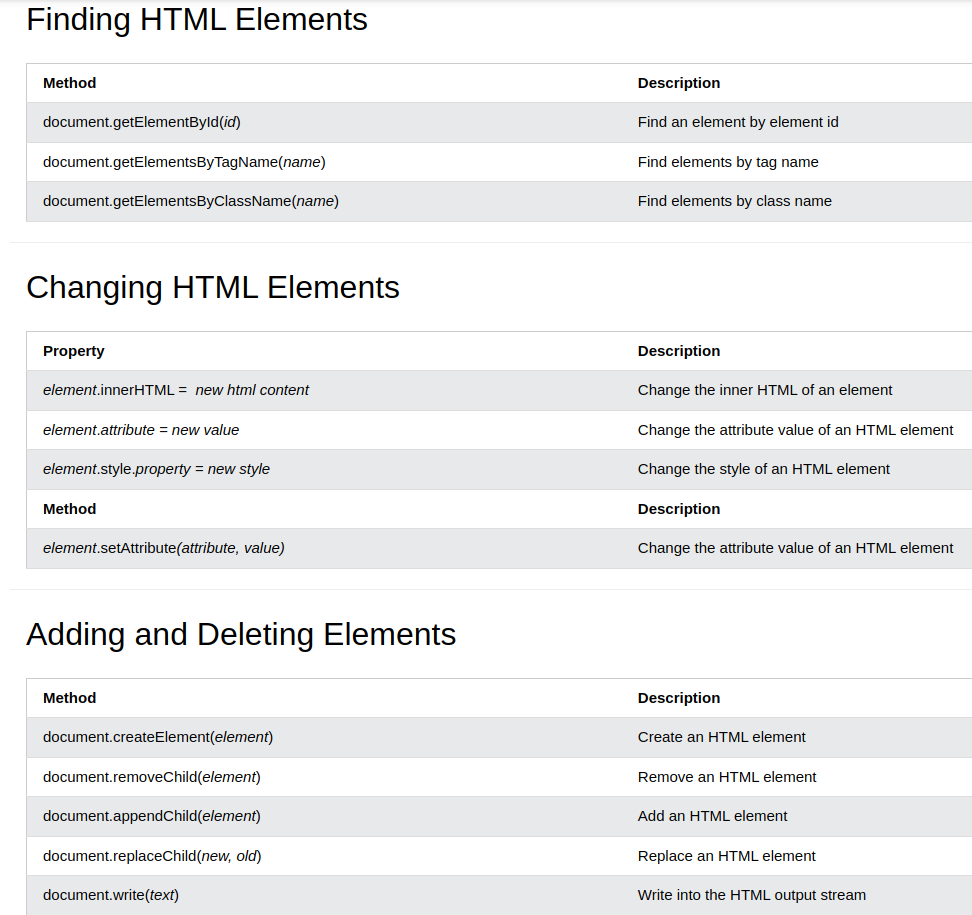
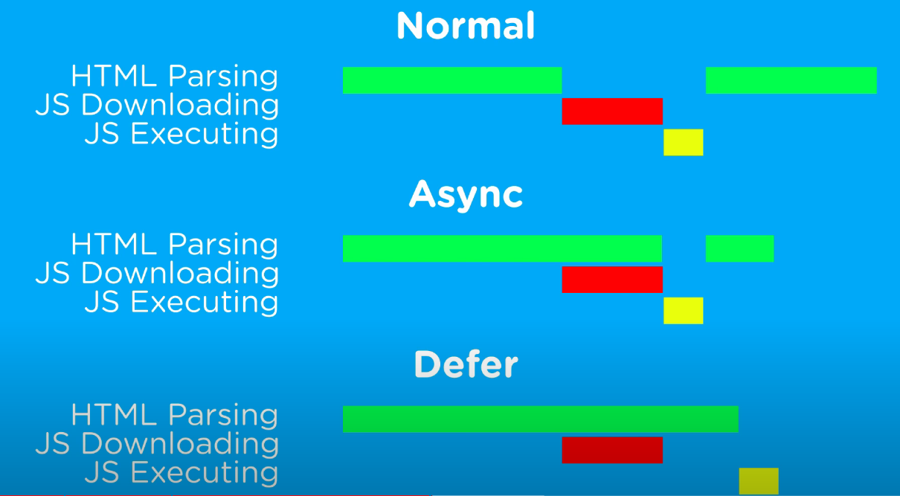
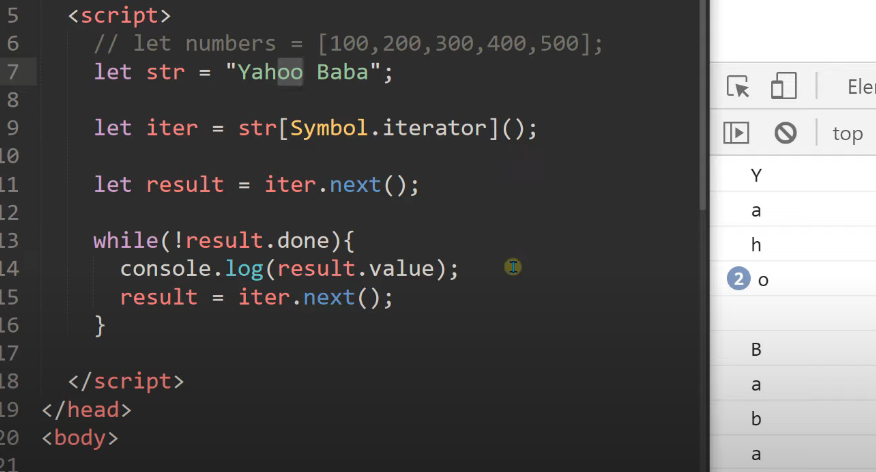
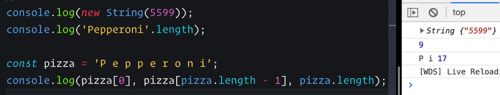

# Javascript

## 1. What is Ecmascript?

- It is a set of guidlines for browsers vendors to provide functinality to ensure the interoperability of web pages across different browsers.

## 2. What is Babel?

- Babel is a free and open-source JavaScript transcompiler that is mainly used to convert ECMAScript 2015+(ES-6) code into backwards-compatible JavaScript code that can be run by older JavaScript engines.
- (If we want to convert new js functinality to old that work was done by babel.)

## 3. What makes JavaScript unique?

There are at least three great things about JavaScript:

- Full integration with HTML/CSS.
- Simple things are done simply.
- Supported by all major browsers and enabled by default.

## 4. Explain Hoisting in javascript.

- Hoisting is the default behaviour of javascript where all the variable and function declarations are moved on top.
- This means that irrespective of where the variables and functions are declared, they are moved on top of the scope. The scope can be both local and global.

Example 1:

```
hoistedVariable = 3;
console.log(hoistedVariable); // outputs 3 even when the variable is declared after it is initialized	
var hoistedVariable;
```

Example 2: 

```
hoistedFunction();  // Outputs " Hello world! " even when the function is declared after calling

function hoistedFunction(){ 
  console.log(" Hello world! ");
} 
```

Example 3:

```
// Hoisting takes place in the local scope as well
function doSomething(){
  x = 33;
  console.log(x);
  var x;
} 
```

**Note - Variable initializations are not hoisted, only variable declarations are hoisted:**

```
var x;
console.log(x); // Outputs "undefined" since the initialization of "x" is not hoisted
x = 23;
```

**Note - To avoid hoisting, you can run javascript in strict mode by using “use strict” on top of the code:**

```
"use strict";
x = 23; // Gives an error since 'x' is not declared
var x;
```


## 4. What is dom(Document Object Model)?

- The Document Object Model (DOM) is a programming interface for HTML and XML documents. It represents the structure of a document as a tree of objects, where each object corresponds to a part of the document, such as an element, attribute, or text. 

  

## 6. 4 Ways to Declare a JavaScript Variable:

- Since JavaScript treats a dollar sign as a letter, identifiers containing $ are valid variable names.
- Using var : if we have not intialize with value it will log undefined in console.
- Using let : block scope
- Using const: can not reassign.
- Using nothing: if you dont use any keyword name then it is automatically declare
- **Variables created without a declaration keyword (var, let, or const) are always global, even if they are created inside a function.**

## 9. var vs let.

- The var and let keywords in JavaScript are both used for declaring variables, but they differ significantly in their scoping rules and hoisting behavior.
  
1. Scoping:
- **var** is function-scoped: A variable declared with var is accessible throughout the entire function in which it is declared
- **let** is block-scoped: A variable declared with let is only accessible within the block (curly braces {}) where it is defined. This includes if statements, for loops, and other block-level constructs.

2. Hoisting:
- **var** variables are hoisted and initialized with undefined: Declarations made with var are "hoisted" to the top of their function scope, meaning you can reference them before their actual declaration in the code. However, they are initialized with undefined until the line of declaration is executed.
- **let** variables are hoisted but not initialized: While let declarations are also hoisted, they are not initialized with a default value. Attempting to access a let variable before its declaration results in a ReferenceError due to the **"Temporal Dead Zone" (TDZ)**.

3. Redeclaration:
- **var** allows redeclaration: You can declare the same variable multiple times within the same scope using var without causing an error.
- **let** prevents redeclaration within the same scope: Attempting to redeclare a let variable within the same block scope will result in a **SyntaxError**.

## Temporal Dead Zone (TDZ):
- The Temporal Dead Zone (TDZ) is the period in JavaScript where a variable declared with let or const is in a "dead zone" and cannot be accessed. This zone starts at the beginning of a block's scope (like a function or curly braces {...}) and ends when the variable is actually declared and initialized. During this time, the variable exists in memory but is uninitialized, so any attempt to access it will result in a ReferenceError.

```
function exampleFunction() {
  // This is the start of the Temporal Dead Zone for 'myVariable'
  // console.log(myVariable); // This would throw a ReferenceError

  let myVariable = 10; // The TDZ ends here
  console.log(myVariable); // This will work correctly
}

exampleFunction();

```
**Benefits:**

- The TDZ helps prevent bugs by stopping developers from using variables before they are properly initialized.
- It makes code more predictable and easier to understand.

## 11. Explain Implicit Type Coercion in javascript.

Example 1:

```
var x = 3;
var y = "3";
x + y // Returns "33" 
```

- **Note - ‘ + ‘ operator when used to add two numbers, outputs a number. 
- The same ‘ + ‘ operator when used to add two strings, outputs the concatenated string:**

- **Note - Type coercion also takes place when using the ‘ - ‘ operator, but the difference while using ‘ - ‘ operator is that, a string is converted to a number and then subtraction takes place.**

```
var x = 3;
Var y = "3";
x - y    //Returns 0 since the variable y (string type) is converted to a number type
```

## JavaScript Operators:

- `**` : `Exponentiation`

  

- typeof: Returns the type of a variable.
- instanceof: Returns true if an object is an instance of an object type.

## The Nullish Coalescing Operator (`??`):

- The nullish coalescing operator is written as two question marks `??`.
- As it treats null and undefined similarly.

```
The result of a ?? b is:

if a is defined, then a,
if a isn’t defined, then b.
```

```
|| returns the first truthy value.
?? returns the first defined value.
```

## The Optional Chaining Operator (?.):

- The ?. operator returns undefined if an object is undefined or null (instead of throwing an error).
- In other words, value?.prop:

- works as value.prop, if value exists,
- otherwise (when value is undefined/null) it returns undefined.

## truthy values & falsy values using `!!`:

- The following values are considered falsy in JavaScript:
  - false
  - 0 (the number zero)
  - -0 (negative zero)
  - 0n (BigInt zero)
  - "", '', `` `` (empty strings)
  - null
  - undefined
  - NaN (Not-a-Number)

- All other values are considered truthy. This includes:
  - Non-zero numbers (e.g., 1, -5, 3.14)
  - Non-empty strings (e.g., "hello", "false", "0")
  - Objects (including empty objects {} and arrays [])
  - Functions
  - true itself

## Switch statement:

- In switch, the cases will use the `===` for comparision not `==`.
- Switch cases use strict comparison (===).

## typeof of NaN will return a Number.

```
alert( NaN === NaN ); // false
```

## toFixed() method :

- used for round off the float value.
- `99.5210.toFixed()` : gives 100
- `99.5210.toFixed(2)` : gives 99.52

## Number Methods:

- Basic number methods can be used on any number:

- toString() : The toString() method returns a number as a string.
- toExponential() : toExponential() returns a string, with a number rounded and written using exponential notation.
- toFixed() : toFixed() returns a string, with the number written with a specified number of decimals:
- toPrecision() : toPrecision() returns a string, with a number written with a specified length:
- valueOf() : valueOf() returns a number as a number

## Strings & Template Literals:

- ways: ` `` `(backticks) , " " , ' '.

- Template Literals use back-ticks (``) rather than the quotes ("") to define a string:
- strings are immutable cannot be changed.

  

## String Methods:

- **Javascript strings are primitive and immutable: All string methods produce a new string without altering the original string.**

- There are 3 methods for extracting a part of a string:

- slice(start, end)
- substring(start, end)
- substr(start, length)

## slice()

- slice() extracts a part of a string and returns the extracted part in a new string.
- The method takes 2 parameters: start position, and end position (end not included).

## substring():

- substring() is similar to slice().
- The difference is that start and end values less than 0 are treated as 0 in substring()

## substr()

- substr() is similar to slice().
- The difference is that the second parameter specifies the length of the extracted part.

## trim():

- It will trim the whitespace string from begin and end.

## padStart()

- The padStart() method pads a string from the start.
- It pads a string with another string (multiple times) until it reaches a given length.

```
Pad a string with "0" until it reaches the length 4:

let text = "5";
let padded = text.padStart(4,"0");
// "0005"
```

## repeat():
- The repeat() method returns a string with a number of copies of a string.
- The repeat() method returns a new string.
- The repeat() method does not change the original string.

```
string.repeat(count)
```

## Converting a String to an Array:

- A string can be converted to an array with the `split()` method.

## JavaScript String Search:

- String indexOf()
- String lastIndexOf()
- String search()
- String match()
- String matchAll()
- String includes() : The includes() method returns true if a string contains a specified value.it is case sensitive.
- String startsWith()
- String endsWith()

## index vs search.

- The search() method cannot take a second start position argument.
- The indexOf() method cannot take powerful search values (regular expressions).

### global search :

- `/aim/g` : Perform a global search for aim.
- `/aim/gi` : Perform a global, case-insensitive search for "aim"

### Interpolation

- Template literals provide an easy way to interpolate variables and expressions into strings.
- means if we have one variable that has value if we want to add it to our string we use `string ${variable_name}` for concatinating our variable with string.
- let firstName = "John";
- let lastName = "Doe";
- let text = `Welcome ${firstName}, ${lastName}!`;

## JavaScript Array Methods

- at():	Returns an indexed element of an array
- concat():	Joins arrays and returns an array with the joined arrays
- entries():	Returns a key/value pair Array Iteration Object
- every():	Checks if every element in an array pass a test

```
// Create an Array
const ages = [32, 33, 16, 40];

// Create a Test Function
function checkAge(age) {
  return age > 18;
}

// Are all ages over 18?
ages.every(checkAge);
```

- fill():	Fill the elements in an array with a static value

- The fill() method fills specified elements in an array with a value.
- The fill() method overwrites the original array.
- Start and end position can be specified. If not, all elements will be filled.

```
Syntax
array.fill(value, start, end)
```

- **filter()**:	Creates a new array with every element in an array that pass a test
- find():	Returns the value of the first element in an array that pass a test
- findIndex():	Returns the index of the first element in an array that pass a test
- findLast():	Returns the value of the last element in an array that pass a test
- findLastIndex():	Returns the index of the last element in an array that pass a test
- **flat()**:	Concatenates sub-array elements
- flatMap():	Maps all array elements and creates a new flat array

```
const myArr = [1, 2, 3, 4, 5, 6];
const newArr = myArr.flatMap(x => [x, x * 10]);

Output: 1,10,2,20,3,30 ...
```

- forEach():	Calls a function for each array element
- includes():	Check if an array contains the specified element

```
Syntax
array.includes(element, start)
```

- indexOf():	Search the array for an element and returns its position
- isArray():	Checks whether an object is an array
- **join()**:	Joins all elements of an array into a string
- **keys()**:	Returns a Array Iteration Object, containing the keys of the original array
- lastIndexOf():	Search the array for an element, starting at the end, and returns its position
- length:	Sets or returns the number of elements in an array
- map():	Creates a new array with the result of calling a function for each array element
- of():	Creates an array from a number of arguments

```
let fruits = Array.of("Banana", "Orange", "Apple", "Mango");
Ans: [ "Banana", "Orange", "Apple", "Mango" ]
```

- **pop():**	Removes the last element of an array, and returns that element
- **push():**	Adds new elements to the end of an array, and returns the new length
- **shift()**:	Removes the first element of an array, and returns that element
- **unshift()**:	Adds new elements to the beginning of an array, and returns the new length


- reverse():	Reverses the order of the elements in an array, The reverse() method overwrites the original array.
- slice():	Selects a part of an array, and returns the new array

- some():	Checks if any of the elements in an array pass a test
- sort():	Sorts the elements of an array

- splice():	Adds or Removes array elements

- toString():	Converts an array to a string, and returns the result
- valueOf():	Returns the primitive value of an array

- with():	Returns a new array with updated elements
- The with() method updates a specified array element.
- The with() method returns a new array.

```
array.with(index, value)


const months = ["Januar", "Februar", "Mar", "April"];
const myMonths = months.with(2, "March");

Ans: Mar -> march
```

## Functions:

### Functions are Objects

- The typeof operator in JavaScript returns "function" for functions.
- The toString() method returns the function as a string:

### Arrow Functions

- Arrow functions allows a short syntax for writing function expressions.
- Arrow functions have no “this”
- You don't need the function keyword, the return keyword, and the curly brackets.
- You can only omit the return keyword and the curly brackets if the function is a single statement.
- Arrow functions are not hoisted. They must be defined before they are used.

## Normal Function Vs Arrow Functions:

- First main diff. is `Syntax`.
- we can write an arrow function in fewer lines. we don't need the function keyword. we can only omit the return keyword and the curly brackets if the function is a single statement.

- Second Main difference between is `this` keywords. In regular functions `this` value is dynamic means if we have a method in any object then the value of `this` referes to particular object where in arrow function `this` not refers to particular object. show below example carefully.

```
let me = {
 name: "Ashutosh Verma",
 thisInArrow:() => {
 console.log("My name is " + this.name); // no 'this' binding here
 },
 thisInRegular(){
 console.log("My name is " + this.name); // 'this' binding works here
 }
};
me.thisInArrow();
me.thisInRegular();
```

**Output:**


## Function Parameters Vs arguments:

- Function parameters are the names listed in the function definition.
- Function arguments are the real values passed to (and received by) the function.when we are calling it.

## Immediately-Invoked Function Expressions (IIFE):

- An Immediately Invoked Function ( known as IIFE and pronounced as IIFY) is a function that runs as soon as it is defined.

Syntax of IIFE :
```
(function(){ 
  // Do something;
})();
```

## Higher Order Functions in javascript.

- Functions that operate on other functions, either by taking them as arguments or by returning them, are called higher-order functions.

```
function higherOrder(fn) {
  fn();
}
```

```
higherOrder(function() { console.log("Hello world") });  
function higherOrder2() {
  return function() {
    return "Do something";
  }
}      
var x = higherOrder2();
x()   // Returns "Do something"
```

## what is function statement?

- when we written function normally it is called function statement.

```
function a(){
console.log("a called");
}
```

## what is function expression?

- when we assign any function to variable it is called expression.

```
var b = function (){
console.log("b called");
}

-- b();
```

-** Difference between them**:

- major diff is hoisting. when we called both a(); and b(); before defining a will return `a called` and for b it is showing `error` because the b is var and it is undefine so it is not callable.

## Anonymous function:

- function with no name is called anonymous function.
- we used this when it will used as values.

## Named function Expression:

```
var b = function `xyz`(){
console.log("b called");
}
```

## First class function: functions are first class citizen

- The ability to pass a function as argument to another function or return a function to another function. or ability to used function as variable.

</hr>

## Function Clousre:

- It return a function with its lexical environment means we get functions bind with its lexical scope where all variables are accessible by its reference.

```
function init() {
var name = 'Mozilla'; // name is a local variable created by init
function displayName() {
// displayName() is the inner function, a closure
console.log(name); // use variable declared in the parent function
}
name = "Harry"
return displayName;
}
let c = init();
c()
```

**Output:**

```
Harry
```

## `this` keyword:

- It is a keyword which reference to a variable of current object.

## Call, Apply and Bind Methods:

- JavaScript provides the call(), apply(), and bind() methods for setting the this context within a function.
- These methods are especially useful when working with object-oriented code or handling different function contexts.

 **`call`** :

 - The Call() Method calls the function directly and sets this to the first argument passed to the call method and
 - If any other sequences of arguments preceding the first argument are passed to the call method then they are passed as an argument to the function.

**Syntax:**

```
call(objectInstance)
call(objectInstance, arg1, /* …, */ argN)
```

**Example:**

```
let nameObj = {
    name: "Tony"
}

let PrintName = {
    name: "steve",
    sayHi: function (age) {
        console.log(this.name + " age is " + age);
    }
}

PrintName.sayHi.call(nameObj, 42); // Tony age is 42
```

`apply` : Same but after writing objectname, if suppose function have extra argument then we can use `[ ]`.

Syntax:
```
apply(objectInstance)
apply(objectInstance, argsArray)
```

```
let nameObj = {
    name: "Tony"
}

let PrintName = {
    name: "steve",
    sayHi: function (...age) {
        console.log(this.name + " age is " + age);
    }
}
PrintName.sayHi.apply(nameObj, [42]); // Tony age is 42
```

- **we can use any of them, but apply will probably be faster, because most JavaScript engines internally optimize it better.**
- **Passing all arguments along with the context to another function is called call forwarding.**

`bind` : The Bind() Method creates a new function and when that new function is called it set this keyword to the first argument which is passed to the bind method, and if any other sequences of arguments preceding the first argument are passed to the bind method then they are passed as an argument to the new function when the new function is called.

Syntax:

```
bind(thisArg)
bind(thisArg, arg1, arg2, /* …, */ argN)
```

**Example:**

```
let nameObj = {
    name: "Tony"
}

let PrintName = {
    name: "steve",
    sayHi: function () {

        // Here "this" points to nameObj
        console.log(this.name); 
    }
}

let HiFun = PrintName.sayHi.bind(nameObj);
HiFun(); // Tony
```

## Function Currying:

- Currying is used in JavaScript to break down complex function calls into smaller, more manageable steps.
- It transforms a function with multiple arguments into a series of functions, each taking a single argument.
- It converts a function with multiple parameters into a sequence of functions.
- Each function takes a single argument and returns another function until all arguments are received.

```
// Normal Function
// function add(a, b) {
//     return a + b;
// }
// console.log(add(2, 3)); 

// Function Currying
function add(a) {
    return function(b) {
        return a + b;
    }
}

const addTwo = add(5);  // First function call with 5
console.log(addTwo(4));
```

### With Arrow function:

```
const add = a => b => a + b;
console.log(add(5)(4));
```

## The "for..in" loop

- To walk over all keys of an object, there exists a special form of the loop: for..in

## Property flags

- Object properties, besides a value, have three special attributes (so-called “flags”):

- `writable` – if true, the value can be changed, otherwise it’s read-only.
- `enumerable` – if true, then listed in loops, otherwise not listed.
- `configurable` – if true, the property can be deleted and these attributes can be modified, otherwise not.

**`Object.preventExtensions(obj)`**

- Forbids the addition of new properties to the object.

**`Object.seal(obj)`**

- Forbids adding/removing of properties. but allow for changing. Sets configurable: false for all existing properties.

**`Object.freeze(obj)`**

- Forbids adding/removing/changing of properties. Sets configurable: false, writable: false for all existing properties.

**`Object.isExtensible(obj)`**

- Returns false if adding properties is forbidden, otherwise true.

**`Object.isSealed(obj)`**

- Returns true if adding/removing properties is forbidden, and all existing properties have configurable: false.

## Frozen Object: `IMP`

- You can make immutable object using the function `Object.freeze(obj)`.
- The object passed to the freeze method will become immutable.
- so we cannot overwrite the value to it's parameter.

```

let obj = {
    a:21,
    b:"test"
} 
obj2 = obj 
obj2.b = "test21"

```

- this will change the value of obj.b and to avoid this we can use `Object.freeze(obj_name)` so this will make object mutable.

## Garbage Collector:

- There’s a background process in the JavaScript engine that is called garbage collector.
- It monitors all objects and removes those that have become unreachable.

- **The basic garbage collection algorithm is called “mark-and-sweep”.**
- **the garbage collector tries to run only while the CPU is idle, to reduce the possible effect on the execution.**
- **Garbage collection is performed automatically. We cannot force or prevent it.**

- Functions that are stored in object properties are called “methods”.
- Methods allow objects to “act” like object.doSomething().
- Methods can reference the object as this.

### Object destructring:

- For finding remaining element of the object we use `...rest` keyword in our destructure object.

## Object.keys, values, entries:

- Object.keys(obj) – returns an array of keys.
- Object.values(obj) – returns an array of values.
- Object.entries(obj) – returns an array of [key, value] pairs.
- `Object.entries(user) = [ ["name","John"], ["age",30] ]`
- Use **Object.fromEntries(array)** on the resulting array to turn it back into an object.

## Types of clone the object:

```

const a = {
  name:"gunjan",
  tech:{
    front:"react",
    aaaa:{
      bbb:"abc"
    }
  }
}

const b = Object.assign({},a); // copy one level means if we change first level it will not change original
const b = {...a} // copy one level means if we change first level it will not change original
const b = JSON.parse(JSON.stringify(a)) // copy deeply and it will not change original
const b = structuredClone(a); // copy deeply and it will not change original

b.name = "dasj"
b.tech.front = "html"
b.tech.aaaa.bbb = "html"
console.log("b",b)
console.log("a",a)

```

## Converting objects into array:

- Any JavaScript object can be converted to an array using Object.values(object_name).

## Converting objects into strings:

- Any JavaScript object can be converted to a string with the JavaScript function `JSON.stringify(object_name)`. but we have to assign this to variable so that variable's type is string.

### Stringify Arrays:

- Any JavaScript array can be converted to a string with the JavaScript function `JSON.stringify(array_name)`:

## JavaScript Arrays:

- Type of array is `object`. arrays are mutable changeable.

## flat methods OR flatten array into one dimention from 2d or 3d.

- let a = [[1],[2,3],4,5,6] convert to [1,2,3,4,5,6]
- for that we use a.flat() will flatten array up to one level means one dimentions.
- for further flatten we pass .flat(2 or 3) 2 or 3 levels.

## join or concat two array using spread opearator or withour using `concat`:

```

// merging array with concat
let alltoppings = toppings.concat(newtoppings);
console.log(alltoppings);

// merging array using spread opearator
let alltoppings1 = [...toppings, ...newtoppings]
console.log(alltoppings1);

```

### Arrays methods:

1. sort:

- it will sort the array and changed the original array.
- it will sort array alphabetically. means it will take element as an strings.
- `arr.sort()`

### How to sort numeric array?

- create compare function given below:

```

function compare = (a,b) =>{ return a-b; }
(a-b: for ascending & b-a for decending order)
then arr.sort(comapre).

```

querySelectorAll() method.
- This example returns a list of all `<p>` elements with class="intro".

- Example:
- const x = document.querySelectorAll("p.intro");

## Difference Between textContents, innerText, and innerHtml?

- `textContents` is all text contained by an element and all its children that are for formatting purposes only.
- `innerText` returns all text contained by an element and all its child elements.
- `innerHtml` returns all text, including html tags, that is contained by an element.

## DOM:

 </br>

## Date:

- JavaScript counts months from 0 to 11:

```

January = 0.
December = 11.

```

## typeof keyword:

- typeof array, object, null, regExp are `object`.
- typeof string is string.
- typeof number,NaN are number.
- typeof undefine is undefine.

## Declaring Strict Mode

- Strict mode is declared by adding "use strict"; to the beginning of a script or a function.

## How JavaScript Code is executed?

- First it will create the global execution context which has two components:

1. memory compo.
2. code component.

- Then it will start executing code line by line and giving the varable value as undefined first and for function it will put whole function code.

- Then after it will again go through line by line and assign value to variable and for `function call` it will again create execution context with memory and code compo.

- for managing this js contain the `callstack` where all execution context are pushed and after executed they will popout from stack.

- `Shortest program in js is no code in js file.`

## Block Scope and Shadowing:

1. Block:

- it is a compound statement. it used for combine multiple js statement into group so js expect/understand the single statement.

2. Block scope:

- The variables or functions are accessible to particular block only.
- `var` is accessible outside the block.
- scope for normal functions and arrow functions are same.

3. Shadowing:

- If we have one variable outside block and same named var inside the block with different value so the in block when we log it will shadowed to outside block & print the inside block's value.
- but it depends on var, let or const when we access it outside and inside.

4. Illegal shadowing:

- ex :

```

let a = 10;
{
var a = 100;
}

```

- this will throw an error named a already declare.
- so when we do shadowing that second variable cannot be accessible outside of its scope.if we used let it will not throw error.

5. lexical scoping:

- it means one scope inside another scope.

## Closures:

- function along with it's lexical scope forms a closures.
- A closure is a function that retains access to its outer function's variables, even after the outer function has finished executing.

## What are Callbacks in JavaScript?

- In JavaScript, callbacks are functions that are passed as arguments from one function to another and are executed after the completion of a certain task. 
- They are commonly used in asynchronous operations, such as reading files, making HTTP requests, or handling user input.

- A function can accept another function as a parameter.
- Callbacks allow one function to call another at a later time.
- A callback function can execute after another function has finished.

- Ex: settimeout, setinterval

## Callback Hell (Pyramid of Doom)

- When multiple asynchronous operations depend on each other, callbacks get deeply nested, making the code hard to read and maintain.
- Callback Hell in JavaScript can be defined as the situation where we have nested callbacks(functions passed as arguments to other functions) which makes the code difficult to read and debug.

## Solution to Callback Hell

- **Promises**
- Promises can help in avoiding the callback hell by providing the structured way to handle the asynchronous operations using the .then() method.
- Due to which the code becomes more readable by avoiding the deeply neseted callbacks.

# Asynchronous Javascript:

## setTimeout:

- It is used when we have to execute our js after some time that we have given.
- The setTimeout() is executed only once.
- syntax:

```

myTimeout = setTimeout(function, milliseconds);

```

Then you can to stop the execution by calling clearTimeout():

```

clearTimeout(myTimeout);

```

- This function will return the id with a number type.

## setInterval:

- It is used when we have to execute our javascript continuosly with some time interval.
- The setInterval() method continues calling the function until clearInterval() is called, or the window is closed.

```

myInterval = setInterval(function, milliseconds);
Then you can to stop the execution by calling clearInterval():
clearInterval(myInterval);

```

## Inversion of control:

- means we are giving our function's control in some other api so it will be risky if API has not calling our function or it call our function many time so this are issues are occur when we use callbacks in our async js.1

## Promises:

- A promise is a special JavaScript object that links the “producing code” and the “consuming code” together. In terms of our analogy: this is the “subscription list”. The “producing code” takes whatever time it needs to produce the promised result, and the “promise” makes that result available to all of the subscribed code when it’s ready.

- Promise handlers .then/.catch/.finally are always asynchronous.
- Even when a Promise is immediately resolved, the code on the lines below .then/.catch/.finally will still execute before these handlers.

- The constructor syntax for a promise object is:

```
let promise = Promise.resolve();
promise.then(() => alert("promise done!"));
alert("code finished"); // this alert shows first
```

```
let promise = new Promise(function(resolve, reject) {
// executor (the producing code, "singer")
});
```

- The function passed to new Promise is called the executor. When new Promise is created, the executor runs automatically.
- Its arguments resolve and reject are callbacks provided by JavaScript itself. Our code is only inside the executor.
- The promise object returned by the new Promise constructor has these internal properties:

- `state` — initially "pending", then changes to either "fulfilled" when resolve is called or "rejected" when reject is called.
- `result` — initially undefined, then changes to value when resolve(value) is called or error when reject(error) is called.

- A promise that is either resolved or rejected is called “settled”, as opposed to an initially “pending” promise.
- An “unhandled rejection” occurs when a promise error is not handled at the end of the microtask queue.

</hr>

### 1. promise state:

- three states: pending, fullfilled, and rejected.

### 2. promise result:

- it stores promise resultant data.
- now after promise object get data we will attach our callbacks with our promise using `.then(callback_function)` function.
- `fetch()` function is used for fetching the external content and it will return a promise object.
- promise object are immutable.

## Promise chaining:

- callback hell issue was solved using promise chaining.
- it is compalsary to return all function which are add in promise chaining.

```

// Callback hell
createOrder(cart, function (orderId) {
  proceedToPayment(orderId, function (paymentInfp) {
    showOrderSummary(paymentInfp, function () {
      updateWalletBalance();
    });
  });
});

// which written as promise chaining
createOrder(cart)
.then(function (orderId) {
return proceedToPayment(orderId);
})
.then(function (paymentInfo) {
return showOrderSummary(paymentInfo);
})
.then(function (paymentInfo) {
return updateWalletBalance(paymentInfo);
});

```

## 2. Creating Promises:

- const promise = `new Promise(function (resolve, reject){ ... content ... })`
- In promises when the promise get resolved or fullfilled it will catch by function callback using .then but if any error occur then we have to show that to user so for that we use `.catch()` method for showing our error.

```

promise
.then(function (orderId) {
console.log(orderId);
})
.catch(function (err) {
alert(err.message);
});

```

- we also catch particular callback function's error also.

## Summary:

- Promise handling is always asynchronous, as all promise actions pass through the internal “promise jobs” queue, also called “microtask queue” (V8 term).
- So .then/catch/finally handlers are always called after the current code is finished.
- If we need to guarantee that a piece of code is executed after .then/catch/finally, we can add it into a chained .then call.

## Promise API:

- There are 6 static methods in the Promise class.

**1. Promise.all**

- Let’s say we want many promises to execute in parallel and wait until all of them are ready.
- For instance, download several URLs in parallel and process the content once they are all done.
- That’s what Promise.all is for.
- The syntax is:

`let promise = Promise.all(iterable);`

- `Promise.all` takes an iterable (usually, an array of promises) and returns a new promise.

```
Promise.all([
  new Promise(resolve => setTimeout(() => resolve(1), 3000)), // 1
  new Promise(resolve => setTimeout(() => resolve(2), 2000)), // 2
  new Promise(resolve => setTimeout(() => resolve(3), 1000))  // 3
]).then(alert);
```

- **If any of the promises is rejected, the promise returned by Promise.all immediately rejects with that error.**

**2. Promise.allSettled**

- Promise.allSettled just waits for all promises to settle, regardless of the result. The resulting array has:

- `{status:"fulfilled", value:result}` for successful responses,
- `{status:"rejected", reason:error}` for errors.
- we can use Promise.allSettled to get the results of all given promises, even if some of them reject.

**3. Promise.race**

- Similar to Promise.all, but waits only for the first settled promise and gets its result (or error).

```
let promise = Promise.race(iterable);
```

**4. Promise.any**

- Similar to Promise.race, but waits only for the first fulfilled promise and gets its result. If all of the given promises are rejected, then the returned promise is rejected with AggregateError – a special error object that stores all promise errors in its errors property.

The syntax is:

```
let promise = Promise.any(iterable)
```

## Export:

- There are two types of exports: Named Exports and Default Exports.

**Named export** :
export class User {...} export default class User {...}
**Default export**
import {User} from ... import User from ...

- **Please note that import/export statements don’t work if inside {...}**

## Event listeners:

## Stoping the bubbling :

- `e.stopPropagation();`

```

const childS = document.querySelector(".child");
childS.addEventListener("click", (e) => {
console.log("child");
e.stopPropagation();
});

```

## Event Occur only once :

- use `{once:true}` at end for listen only once.

```

const parent = document.querySelector(".parent");
parent.addEventListener(
"click",
(e) => {
console.log("parent");
},
{ once: true }
);

```

## Event Deligation:

- Insted of attaching eventlistener to all child element we can attach it to parent's.
- event deligation will depend on the event bubbling.
- Behaviour patterns achieve using delogation. means converting entered input to uppercase:

Benifits:

- saves lot of memory.
- writing less code
- dom manipulation (if we have attach to parent then if any extra child element is added then we no need to write eventlisteners for them)

loss:

- all events are not bubbled up.
- if we used stop propogation then it cannot used.

## Event Loop:

- it is checked whether the call stack is empty or not if empty then it will checked to microtask queue and if any function is there so it will send it to call stack and if not then it will check the callback queue if there any function then it will send to callstack .

## Browser layout:


## Microtask Queue:

- All the callback function that are fall through the promises will go inside the microtask queue. and it is called mutation oberver.

## fetch():

- it is a window object used for accessing the external content or accessing the API's. And it can be used with the promises.

## alert, prompt, confirm:

### alert

- This one we’ve seen already. It shows a message and waits for the user to press “OK”.

### prompt

The function prompt accepts two arguments:

```

result = prompt(title, [default]);

```

- title : The text to show the visitor.
- default: An optional second parameter, the initial value for the input field.

### confirm

The syntax:

```

result = confirm(question);

```

- The function confirm shows a modal window with a question and two buttons: OK and Cancel.

## JSON:

`JSON.stringify`: to convert JS objects into JSON.
`JSON.parse`: to convert JSON back into an javascript object.

- JSON is data-only language-independent specification, so some JavaScript-specific object properties are skipped by JSON.stringify.

  **Namely:**

- Function properties (methods).
- Symbolic keys and values.
- Properties that store undefined.

**Example:**

```

let user = {
sayHi() { // ignored
alert("Hello");
},
[Symbol("id")]: 123, // ignored
something: undefined // ignored
};

alert( JSON.stringify(user) ); // {} (empty object)

```

## Limitations:

- The important limitation: there must be no circular references.

## Functional programming:

- are resusability, modularity, composition.

## Error Handling:

- It is used to handle or show our errors in document.
- for catching the error we use `try`...`catch` block.
- A code we write in our try block and if that try block's code has error then the control will go to the catch block and our error message is shown that we have written in our catch block.
- we can also add custom error message or the error that has occured that we also catch it.
- But this try catch will only properly run on the synchronous Js. it will not properly work on Async. Js like setTimeout or interval.
- And if we want to add it to setTimeout then we have to add try catch inside the setTimeout.
- `finally`: it written at last and after catch block and whatever code is written in that block is always run whether try has run or catch has run.

### Types of error:

```

EvalError
RangeError
ReferenceError
SyntaxError
TypeError
URIError
AggregateError

```

## Async / await:

- There is a special syntax to work with promises in javascript.
- A function is made async using an async keyword before function.
- The word “async” before a function means one simple thing: a function always returns a promise. Other values are wrapped in a resolved promise automatically.

```
async function hibye(){
  return 7;
}

hibye().then(alert)
```

### await:

- there is another keyword await that only works inside the async functions.

```
let value = await promise;
```

- The await keywords makes JS wait untill the promise settles or fullfilled or resolve and return its value to variable

## Loading the javascript or how Html is parse?.

## Async Vs Defer Vs Normal way to

- `async` and `defer` are the attributes that are used in the script tag.
- when we are load a webpage at that time two events are occur: 1. Html parsing and 2. Js downloading



## Debouncing vs Throttling:

- This two are the ways or solutions to avoiding or making the unnecessary api calls.

### case studies:

- Suppose we have a search bar so insted of calling the api on every key press it is more convinient to make api call when the time difference between the two key press is more than some time. so for this method is called debouncing.
- where in the case of throttling we can set certain time interval it will call that api after every 10 second like that.

- other scenario is that resizing the window, pressing the button, or click on the screen like when we are playing the game so that time for shooting the gun like for machine gun we can set time interval for shooting time like 100ms and for the pistol we can set more time interval.

- which method is better ?
- so it is totally depends on the usecase or scenario we have.

## Symbol:

- it is a new datatype which is used for unique values.

## Iterators:

- It is a method that is used to iterate over the strings, objects and arrays.
- It performs the operations like others which are forin foreach and forof etc but the diff between them is for filtering we have to add if statement on each loop where in iterator it become more easier.

```

let numbers = [100, 200, 300];
let iter = numbers [Symbol.iterator]();
iter.next();
console.log(iter.next().value);
console.log(iter.next().done);

```

- Iterator with string.



## Generators:

- Regular functions return only one, single value (or nothing).
- Generators can return (“yield”) multiple values, one after another, on-demand.
- To create a generator, we need a special syntax construct: function\*, so-called “generator function”.
- Generator functions behave differently from regular ones. When such function is called, it doesn’t run its code. Instead it returns a special object, called “generator object”, to manage the execution.

```
function* generateSequence() {
  yield 1;
  yield 2;
  return 3;
}

// "generator function" creates "generator object"
let generator = generateSequence();
alert(generator); // [object Generator]
```

- The main method of a generator is next(). When called, it runs the execution until the nearest yield <value> statement (value can be omitted, then it’s undefined). Then the function execution pauses, and the yielded value is returned to the outer code.
- The result of next() is always an object with two properties:
- `value`: the yielded value.
- `done`: true if the function code has finished, otherwise false

```
let one = generator.next();
alert(one) // gives value and done
```

**Generators are iterable**

- As you probably already guessed looking at the next() method, generators are iterable.
- We can loop over their values using for..of:

### Accessing properties & length properties:



## Deep copy/cloning Or Shallow copy/cloning:

1. Shallow copy will make copy but if we changed any items in copied object then it will changed that item in main object also.

- for this we try `newObject = old_object` ;

2. Deep copy will make copy but if we changed any item in copied object then it will not changed into main object.

- for that we use `newobject = JSON.parse(JSON.stringify(old_object_name))`.

## what is pure functions:

- Pure functions are functions that don't produce side effects and, when called with the same input parameters, will always return the same output. You can use pure functions to ensure your code is clean, maintainable, and testable.

- The **return value** of the function on the function call should only be dependent on the input function arguments.

- It should not **modify any non-local** state. It means the function should not manipulate anything other than the data stored in the local variables declared within the function.

- The function should not have any side effects, such as reassigning non-local variables, mutating the state of any part of code that is not inside the function, or calling any non-pure functions inside it.

```

function operationAdd(a, b){ // A pure function adding two integers passed in it.
return a+b;
}

function operationDivide(a, b){ // Pure function to divide two integers passed in it.
return a/b;
}

function operationMulti(a, b){ // Pure function to multiple two integers passed in it.
return a\*b;
}
console.log( // Calling all the pure functions
operationAdd(2,5),
operationMulti(3,2),
operationDivide(20,5)
);

```

- No side effects some common side effects:
- Making an HTTP request
- Mutating any data that is not part of the function
- Printing to a screen or console
- DOM Query/Manipulation
- Using Math.random()
- Getting the current time

## BreakPoints:

- A breakpoint is a point of code where the debugger will automatically pause the JavaScript execution.
- While the code is paused, we can examine current variables, execute commands in the console etc. In other words, we can debug it.

- `Watch` – shows current values for any expressions.
- `Call Stack` – shows the nested calls chain.
- `Scope` – current variables.

## Transpilers

- A transpiler is a special piece of software that translates source code to another source code. It can parse (“read and understand”) modern code and rewrite it using older syntax constructs, so that it’ll also work in outdated engines.

- Speaking of names, Babel is one of the most prominent transpilers out there.

## Polyfills

- Polyfills are like handy tools that web developers can use to make their websites work properly even if some web browsers don't support certain features.
- They work by checking if a browser can understand and use a particular feature. If the browser can handle it, the polyfill steps aside and lets the browser do its thing.
- But if the browser doesn't support the feature, the polyfill jumps in and provides its own version of that feature, so the website still functions correctly.
- For example, Math.trunc(n) is a function that “cuts off” the decimal part of a number, e.g Math.trunc(1.23) returns 1.
- They work by checking if a browser can understand and use a particular feature. If the browser can handle it, the polyfill steps aside and lets the browser do its thing. But if the browser doesn't support the feature, the polyfill jumps in and provides its own version of that feature, so the website still functions correctly

## Two interesting polyfill libraries are:

- `core js` that supports a lot, allows to include only needed features.
- `polyfill.io` service that provides a script with polyfills, depending on the features and user’s browser.

## Map

- Map is a collection of keyed data items, just like an Object. But the main difference is that Map allows keys of any type.

- Methods and properties are:

- new Map() – creates the map.
- map.set(key, value) – stores the value by the key.
- map.get(key) – returns the value by the key, undefined if key doesn’t exist in map.
- map.has(key) – returns true if the key exists, false otherwise.
- map.delete(key) – removes the element (the key/value pair) by the key.
- map.clear() – removes everything from the map.
- map.size – returns the current element count.

## Iteration over Map

For looping over a map, there are 3 methods:

- map.keys() – returns an iterable for keys,
- map.values() – returns an iterable for values,
- map.entries() – returns an iterable for entries [key, value], it’s used by default in for..of.

## Set

A Set is a special type collection – “set of values” (without keys), where each value may occur only once.

Its main methods are:

- new Set([iterable]) – creates the set, and if an iterable object is provided (usually an array), copies values from it into the set.
- set.add(value) – adds a value, returns the set itself.
- set.delete(value) – removes the value, returns true if value existed at the moment of the call, otherwise false.
- set.has(value) – returns true if the value exists in the set, otherwise false.
- set.clear() – removes everything from the set.
- set.size – is the elements count.

## Mixins

- In JavaScript we can only inherit from a single object. There can be only one [[Prototype]] for an object. And a class may extend only one other class.
- we have a class User and a class EventEmitter that implements event generation, and we’d like to add the functionality of EventEmitter to User, so that our users can emit events.
- There’s a concept that can help here, called “mixins”.
- a mixin is a class containing methods that can be used by other classes without a need to inherit from it.
- In other words, a mixin provides methods that implement a certain behavior, but we do not use it alone, we use it to add the behavior to other classes.

**Example:**

```
// mixin
let sayHiMixin = {
  sayHi() {
    alert(`Hello ${this.name}`);
  },
  sayBye() {
    alert(`Bye ${this.name}`);
  }
};

// usage:
class User {
  constructor(name) {
    this.name = name;
  }
}

// copy the methods
Object.assign(User.prototype, sayHiMixin);

// now User can say hi
new User("Dude").sayHi(); // Hello Dude!
```

# BOM:

## how to create cutome html element?
- customeElement.define(name,constructor,?options)

**clientWidth & clientHeight:**

- content height + padding.
- **margine, border,scroll height/width not included.**
- clientWidth and clientHeight does NOT work with inline HTML elements (like span, em, or a). It’ll just return 0!

**offsetWidth & offsetHeight**

- content height + padding + border + scrollbar
- **margin not included**.
- offsetWidth/offsetHeight – “outer” width/height of an element including borders.
- 

- **let coords = elem.getBoundingClientRect()**

**scrollWidth/Height**
- content which was overflow that height.

## The difference: CSS width versus clientWidth

- clientWidth is numeric, while getComputedStyle(elem).width returns a string with px at the end.
- getComputedStyle may return non-numeric width like "auto" for an inline element.
- clientWidth is the inner content area of the element plus paddings, while CSS width (with standard box-sizing) is the inner content area without paddings.
- The clientWidth property is always the same: scrollbar size is substracted if reserved.

**Place the ball in the field center:**

```
ball.style.left = Math.round(field.clientWidth / 2 - ball.offsetWidth / 2) + 'px';
ball.style.top = Math.round(field.clientHeight / 2 - ball.offsetHeight / 2) + 'px';
```

## addEventListener

- The fundamental problem of the aforementioned ways to assign handlers is that we can’t assign multiple handlers to one event.
- `element.addEventListener(event, handler, [options]);`

**options**

- An additional optional object with properties:

- `once`: if true, then the listener is automatically removed after it triggers.
- `capture`: the phase where to handle the event {capture: false/true}. for bubbling and capturing.
- `passive`: if true, then the handler will not call `preventDefault()`

- same for removeEventListeners
- `element.removeEventListener(event, handler, [options]);`

## `DOMContentLoaded`:

- That triggers when the document is loaded and the DOM has been built.

```
document.addEventListener("DOMContentLoaded", function() {
  alert("DOM built");
});
```

## Event Object:

- Some properties of event object:

- `event.type`
  Event type, here it’s "click".
- `event.currentTarget`
  Element that handled the event.
- `event.eventPhase`
  The current phase (capturing=1, target=2, bubbling=3).
- `event.clientX / event.clientY`
  Window-relative coordinates of the cursor, for pointer events.

- When an event occurs, its handleEvent method is called.

**Example:**

- Create a button that hides itself on click.
- `<input type="button" onclick="this.hidden=true" value="Click to hide">`

### Which handlers run?

```
button.addEventListener("click", () => alert("1"));

button.removeEventListener("click", () => alert("1"));

button.onclick = () => alert(2);
```

- The answer is 1 and 2.

## Bubbling

- The bubbling principle is simple.
- When an event happens on an element, it first runs the handlers on it, then on its parent, then all the way up on other ancestors.

**Ex:**

- if we have `FORM > DIV > P`
- So if we click on <p>, then we’ll see 3 alerts: `p → div → form`.
- The process is called “`bubbling`”, because events “bubble” from the inner element up through parents like a bubble in the water.
- For instance, a focus event does not bubble.

## event.target

- A handler on a parent element can always get the details about where it actually happened.
- The most deeply nested element that caused the event is called a target element, accessible as event.target.
- Note the differences from this (=event.currentTarget):
- **event.target** – is the “target” element that initiated the event, it doesn’t change through the bubbling process.
  **this** – is the “current” element, the one that has a currently running handler on it.

- so in the above example the `this` refers to current element which is form. event.target is the actual element inside the form that was clicked.

## Stopping bubbling

- A bubbling event goes from the target element straight up. Normally it goes upwards till `<html>`, and then to document object, and some events even reach window, calling all handlers on the path.
- But any handler may decide that the event has been fully processed and stop the bubbling.
- The method for it is **event.stopPropagation()**

## event.stopImmediatePropagation()

- If an element has multiple event handlers on a single event, then even if one of them stops the bubbling, the other ones still execute.
- In other words, event.stopPropagation() stops the move upwards, but on the current element all other handlers will run.
- To stop the bubbling and prevent handlers on the current element from running, there’s a method event.stopImmediatePropagation(). After it no other handlers execute.

## Capturing

- There’s another phase of event processing called “capturing”. It is rarely used in real code, but sometimes can be useful.

- The standard DOM Events describes 3 phases of event propagation:
- `Capturing phase` – the event goes down to the element.
- `Target phase` – the event reached the target element.
- `Bubbling phase` – the event bubbles up from the element.

- To catch an event on the capturing phase, we need to set the handler capture option to true
- false value is by default.

```
elem.addEventListener(..., {capture: true})

// or, just "true" is an alias to {capture: true}
elem.addEventListener(..., true)
```

- In other words, normally the event goes first down (“capturing”) and then up (“bubbling”). But if event.stopPropagation() is called during the capturing phase, then the event travel stops, no bubbling will occur.


## event.preventDefault()

- Many browser events have a “default action”, such as navigating to a link, starting a selection, and so on.
- By calling event.preventDefault(), an event handler may send a signal that those actions should be canceled.

## Crossorigin policy

- There’s a rule: scripts from one site can’t access contents of the other site. So, e.g. a script at https://facebook.com can’t read the user’s mailbox at https://gmail.com.
- Or, to be more precise, one origin (domain/port/protocol triplet) can’t access the content from another one. So even if we have a subdomain, or just another port, these are different origins with no access to each other.
- To allow cross-origin access, the `<script>` tag needs to have the crossorigin attribute, plus the remote server must provide special headers.

- `No crossorigin attribute` – access prohibited.
- `crossorigin="anonymous`" – access allowed if the server responds with the header Access-Control-Allow-Origin with \* or our origin. Browser does not send authorization information and cookies to remote server.
- `crossorigin="use-credentials"` – access allowed if the server sends back the header Access-Control-Allow-Origin with our origin and Access-Control-Allow-Credentials: true. Browser sends authorization information and cookies to remote server.

## Mutation observer

- MutationObserver is a built-in object that observes a DOM element and fires a callback when it detects a change.

## Syntax:

- Easy to use
- First, we create an observer with a callback-function:
- `let observer = new MutationObserver(callback);`
- `observer.observe(node, config);`

config is an object with boolean options “what kind of changes to react on”:

`childList` – changes in the direct children of node,
`subtree` – in all descendants of node,
`attributes` – attributes of node,
`attributeFilter` – an array of attribute names, to observe only selected ones.
`characterData` – whether to observe node.data (text content),

## When such thing may be useful?

Imagine the situation when you need to add a third-party script that contains useful functionality, but also does something unwanted, e.g. shows ads `<div class="ads">Unwanted ads</div>`.

Naturally, the third-party script provides no mechanisms to remove it.

Using MutationObserver, we can detect when the unwanted element appears in our DOM and remove it.

There are other situations when a third-party script adds something into our document, and we’d like to detect, when it happens, to adapt our page, dynamically resize something etc.

MutationObserver allows to implement this.


## storing data in browser:

### `cookie`:

- Cookies are small strings of data that are stored directly in the browser. They are a part of the HTTP protocol.
- Cookies are usually set by a web-server using the response Set-Cookie HTTP-header. Then, the browser automatically adds them to (almost) every request to the same domain using the Cookie HTTP-header.
- One of the most widespread use cases is authentication:
- We can also access cookies from the browser, using document.cookie property.
- One cookie may not exceed 4KB in size. The number of cookies allowed on a domain is around 20+ (varies by browser).
- **the cookie dies when the browser is closed.**

### sessionStorage

- The sessionStorage object is used much less often than localStorage.

- Properties and methods are the same, but it’s much more limited:
- The sessionStorage exists only within the current browser tab.
- Another tab with the same page will have a different storage.
- But it is shared between iframes in the same tab (assuming they come from the same origin).
- The data survives page refresh, but not closing/opening the tab.

- The limit is 5mb+,
