https://github.com/sudheerj/reactjs-interview-questions?tab=readme-ov-file#what-is-the-difference-between-createelement-and-cloneelement

# ReactJs:

- React is a free and open-source front-end JavaScript library for building user interfaces based on components, especially for single-page applications. It is maintained by Meta

# Features:

The major features of React are:

- Uses JSX syntax, a syntax extension of JS that allows developers to write HTML in their JS code.
- It uses Virtual DOM instead of Real DOM considering that Real DOM manipulations are expensive.
- Supports server-side rendering which is useful for Search Engine Optimizations(SEO).
- Follows Unidirectional or one-way data flow or data binding. means it will render the components from parent to child.
- Uses reusable/composable UI components to develop the view.

## Code Splitting:

- Instead of bundling your entire app into one big JavaScript file that the browser must download, parse, and execute before anything becomes interactive, you break it into smaller chunks that load on demand — only when a given route, component, or interaction actually needs them.

### How it improves performance:
- **Smaller initial payload** → faster download, especially on mobile/slow networks.
- **Less main-thread work up front** → the browser parses/compiles less JS before the page responds. This directly improves TBT (Total Blocking Time), TTI, and INP.

## passed by value and passed by reference:

The rule in JavaScript

- Primitives (number, string, boolean, null, undefined, symbol, bigint) are passed by value — the function gets a copy. Changing it inside the function does not affect the caller.
- Objects (including arrays, Set, Map, functions) are passed by reference* — the function gets a copy of the reference pointing to the same object in memory. Mutating the object's contents is visible to the caller.

▎ *Technically JS is always "pass by value" — but for objects the value being copied is the reference/pointer. That's why reassigning the parameter doesn't affect the caller, but mutating its properties does. This is often called "call by sharing."

- **Create react component without JSX:**

```
import React from 'react'

const Hello = () =>{
  return React.createElement('div',classname or extra info if not then null,here the innertext or childeren element)
  return React.createElement('div',{className:"container"}, 'h1', 'Hello')
  // here h1 is child element and after that is inner text
}

```

**Changes:**

- `for` to `htmlFor`
- `class` to `className`
- Also supports the camelcase name in property.

## **1. Virtual DOM:**
- Virtual DOM is the virtual representation of Real DOM
- React update the state changes in Virtual DOM first and then it syncs with Real DOM
- Virtual DOM is just like a blueprint of a machine, can do changes in the blueprint but those changes will not directly apply to the machine.
- Virtual DOM makes the performance faster, not because the processing itself is done in less time. The reason is the amount of changed information – rather than wasting time on updating the entire page, you can dissect it into small elements and interactions

## Differences between Virtual DOM and Real DOM


## When to use a Class Component over a Function Component?
- there are two reasons to use Class components over Function components.

1. If you need a React functionality whose Function component equivalent is not present yet, like Error Boundaries.
2. In older versions, If the component needs state or lifecycle methods then you need to use class component.

## Fragments:

- `<> write your jsx here </>`
- it is wrap the jsx.
- React Fragment is a feature in React that allows you to return multiple elements from a React component by allowing you to group a list of children without adding extra nodes to the DOM.

## React Fragment vs Div Element

- In React, "`Fragment`" and "`Div`" are used interchangeably. The main difference between the two is that "Fragment" clears out all extra divs from a DOM tree while "Div" adds a div to the DOM tree.

## Advantages of Fragment:

- The code readability of React Fragment is higher
- Because React fragments have a smaller DOM, they render faster and use less memory.

# React Strictmode: 
- StrictMode is a development-only diagnostic wrapper that helps catch bugs early by intentionally exercising edge cases:

### Usage:

- Double-invokes function component bodies, and effects (useEffect/useState initializers) on mount in dev.
- Warns on deprecated/unsafe lifecycle patterns and legacy APIs
- **It has zero effect in production builds — the double-invoking behavior only happens in development, so it costs nothing at runtime for real users.**

### What if we remove StrictMode?

- The app would still work identically today, in dev and prod
- I'd lose the early-warning safety net
- **For Ex: if I later add a fetch or subscription that isn't cleaned up properly) could silently pass in dev and only surface later as a subtle production bug**
- I'd also stop getting forward-compatibility warnings for deprecated APIs

# Components:

- two types of components:
- 1. stateless functional components.
- 2. statefull class components.

## What is controlled and uncontrolled component in React js?

**1. Controlled Components:**

- A controlled component is a component in which the value of an input element (such as `<input>`, `<textarea>`, or `<select>`) is controlled by React state.
- In a controlled component, the value is stored in the component's state, and the component updates the value in response to user input through event handlers like onChange. The component re-renders whenever the state changes, and the value is updated accordingly.

**Example:**

```
class ControlledInput extends React.Component {
  constructor(props) {
    super(props);
    this.state = { value: '' };
  }

  handleChange(event) {
    this.setState({ value: event.target.value });
  }

  render() {
    return (
      <input
        type="text"
        value={this.state.value}
        onChange={(event) => this.handleChange(event)}
      />
    );
  }
}

```

**2. Uncontrolled Components:**

- An uncontrolled component is a component in which the value of an input element is managed by the DOM itself rather than by React state.
- In an uncontrolled component, you rely on the DOM's own state management to handle the value of the input.
- You can access the value using a ref or by querying the DOM directly.

- **Example:**

```
import React from "react";

class UncontrolledInput extends React.Component {
  handleSubmit(event) {
    event.preventDefault();
    console.log(this.inputRef.value);
  }

  render() {
    return (
      <form onSubmit={(event) => this.handleSubmit(event)}>
        <input type="text" ref={(input) => (this.inputRef = input)} />
        <button type="submit">Submit</button>
      </form>
    );
  }
}

```

## Differences:


## What are React keys and why are they important?

- Answer: React keys are special attributes that provide a unique identity to each element in a collection rendered by a React component.
- They help React identify which items have changed, been added, or been removed from a list.

**Always start component names with a capital letter.**

- React treats components starting with lowercase letters as DOM tags. For example, `<div />` represents an HTML div tag, but `<Welcome />` represents a component and requires Welcome to be in scope.

# 4 Ways to create react component:

## Functional Components:

- Also called `dull` or `template` components, their main purpose is to receive props/return JSX.

```

import React from 'react';
const HelloWorld = () => {
    return (
    <span>Hello!</span>
    )
}

export default HelloWorld;

```

**Default exports vs Named exports**:

- In `Default exports` we can change the name of component when we are importing them and where in `named exports` we can directly write export before function name so we can not chanegd the function name when we are importing them.

## Class Components:

- They can do everything a functional component does, but more.
- Also called smart components.
- They can receive props, have state and lifecycle methods.
- We use and connect all functional components.

```
import React from 'react';
class HelloWorld extends
React.Component {
    // LOGIC HERE
    render() {
        return (
        <span>Hello!</span>
        )
    }
}

export default HelloWorld;

```

**Functional Components Vs Class components:**

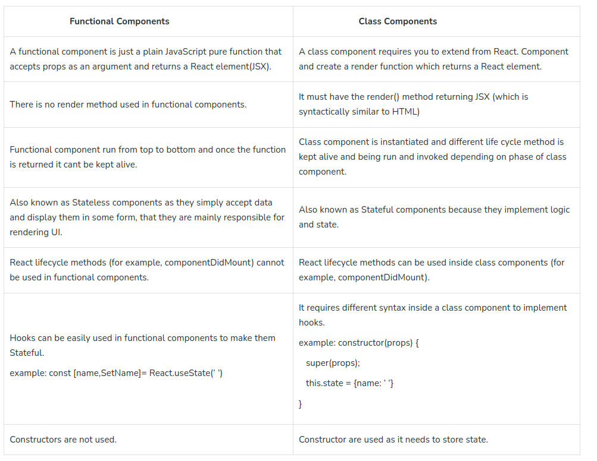

- One scenario where we implement only class is the error handling life cycle method.

## Pure Components:

- This is generally used for optimizing the application.
- It reduce the unnecessary rendering.
- The pure components are also used for increasing performance as it works like shouldComponentUpdate() lifecycle methods which will reduce the number of operations in the application.

- For Example, if we have one parent component and it has two child component in which one is regular and second is pure and we had write set interval method in the parent component and we are not changing any thing in parent, so parent will re render after evry two second and one regular child component will also re render but the child pure compo will render only once after that it checks if there is no change then it will not re render.
- so to reduce this un necessary re render of component we use pure component.

## Working:

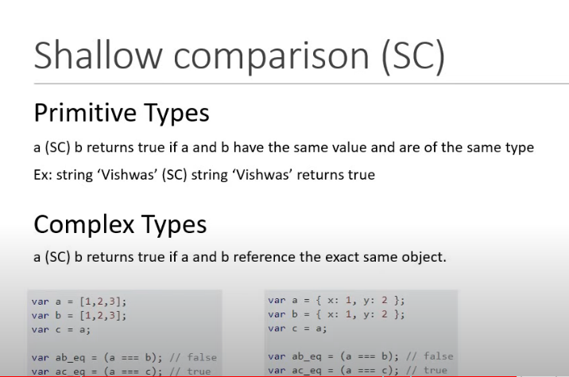

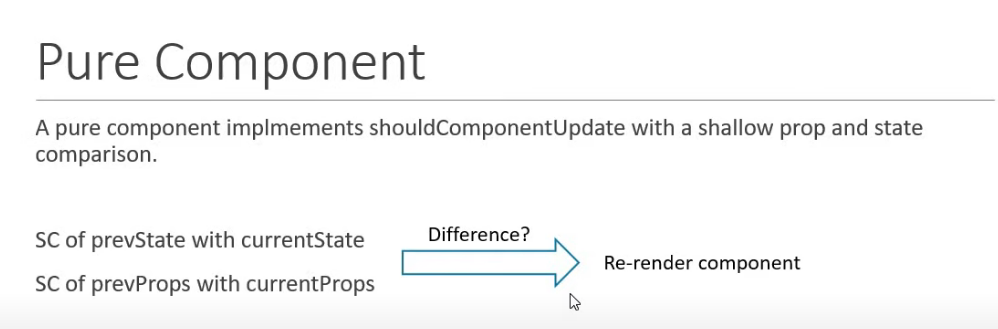

## Diff between Regular compo vs Pure component.

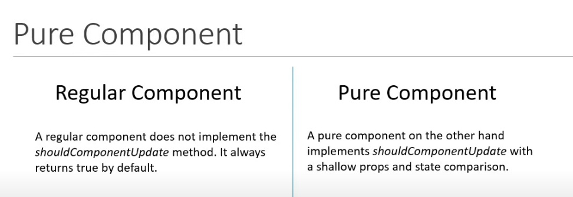

## Summary

- We can create a component by extending the PureComponent class.
- A PureComponent implements the shouldComponentUpdate lifecycle method by performing a shallow comparison on the props and state of the component.
- If there is no difference, the component is not re-rendered - performance boost.
- It is a good idea to ensure that all the children components are also pure to avoid unexpected behaviour.
- Never mutate the state. Always return a new object that reflects the new state.

## Higher Order Components (HOC):

- To share common functionality between components

- 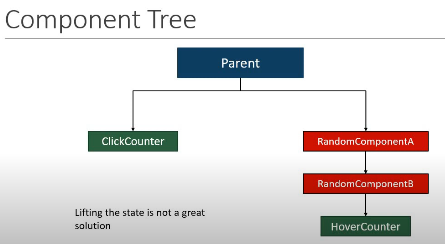

## What is HOC?

- A pattern where a function takes a component as an argument and returns a new component.
- They don't modify the original component: HOCs create a new component and leave the original component untouched. They act as wrappers around the component, providing the desired enhancements
- **const NewComponent = higherOrderComponent(original Component)** </br>
  **const Enhanced Component = higherOrderComponent( original Component)**</br>
  **const IronMan = withSuit( TonyStark)**

## Usage:

- To make use of this we have first one component in which we have to add common functionality and take any function as an argumenet and modify that and return the updated component. see below code:

```
const UpdatedComponent = (OriginalComponent) => {
  class NewComponent extends React.Component {
    constructor(props) {
      super(props);
      this.state = {
        count: 0,
      };
    }

    incrementCount = () => {
      this.setState((prevState) => {
        return { count: prevState.count + 1 };
      });
    };

    render() {
      return (
        <OriginalComponent
          count={this.state.count}
          incrementCount={this.incrementCount}
        />
      );
    }
  }
  return NewComponent;
};

export default UpdatedComponent;
```

- And on the other component by this below:

```
class HOC_count extends Component {
  render() {
    const { count, incrementCount } = this.props;
    return (
      <div>
        <button onClick={incrementCount}>Count- {count}</button>
      </div>
    );
  }
}

export default UpdatedComponent(HOC_count);
```


## if we have object whoose value not changing and we pass that object as props so is that child component will render ?

- In React, when a component receives new props, it triggers a re-render by default, regardless of whether the props have changed. This behavior applies to both primitive values and object references passed as props.

- If you pass an object reference as a prop to a child component and the object's value remains the same (i.e., the reference remains unchanged), the child component will still re-render.

- React performs a shallow comparison of props to determine if a re-render is necessary. It compares the previous props with the new props by checking if the references are different. Since the object reference remains the same, React considers the props to have changed and triggers a re-render of the child component.

- To optimize the rendering in cases where the object's value remains the same, you can use the React.memo higher-order component or the useMemo hook to memoize the child component. This prevents unnecessary re-renders if the props have not changed.

## React memo:

- memo lets you skip re-rendering a component when its props are unchanged.
- React.memo is a higher-order component (HOC) that memoizes the rendered output of the child component. It compares the previous and new props and re-renders the component only if there are differences. it implements shouldComponentUpdate.
- React.memo performs a shallow comparison of the prop values. If the values are shallowly equal (using Object.is), the component is not re-rendered.
- memo returns a new React component.
- Ex:
```
childComponent.jsx

export default React.memo(ChildComponent);
```
- React.memo should not be overused, especially when the child component is lightweight or renders quickly.
- The memoization process itself has some overhead, so applying it to every component indiscriminately can introduce unnecessary complexity and potentially hinder performance


# props:

- we can pass the props from where we have import particular component and we can pass props by `name="value"` format.
- and we can use that in that component by passing `props` and using `props.name` .
- we can also pass props as directly its name by passing {props_name} and use it.
- we can also set the default props value if any props were not passed.
- we can also set the type of props by importing `impt : import PropTypes from "prop-types"; ` and use it like below:
- In class component we can use `this.props.prop-name `.

```
<!-- set the default prop value -->
Header.defaultProps = {
  text: "Default text",
};

Header.propTypes ={
  text: PropTypes.type-of-prop,
}
```

## Passing Object as props:

- for passing the object as props we have to destructure props at child component.

```
Parent compo.

  const item1 = {
    title: "Title 1",
    paragraph: "Lorem ipsum dolor sit amet consectetur adipisicing elit",
  };
  <Fragments items={item1} />

child compo.

const Fragments = function ({ items }) {
  return (
    <>
      <h1>{items.title}</h1>
      <h3>{items.paragraph}</h3>
    </>
  );
};

```

## Destructring of props:

- pass props in child component and write below in ur child:

parent:

```
  <Child name="dasf" heroName="d3rwrfd" />
```

```
const {name, heroName } = props
and in class component use `this.props`
and now use directly name and heroName in ur element

```

## Add style to components:

```
<header style={{ backgroundColor: "blue", color: "white" }}>
  <div className="container">
    <h2>{text}</h2>
  </div>
</header>

```

## `State` in Class Components

- state are managed in the component.
- In class component we have to pass one arrow function in our button event(click) which return our function and that function we have to define in our class.
- **`<button onClick={() => { this.changeMessage();}} >`**
- OR We can use bind method:
- **`<button onClick={this.changeMessage.bind(this)} >`**
- OR we can use arrow function for our onclick events:
- **`<button onClick={this.changeMessage} >`**
- we can target state using `this` keyword in class component.
- Always make use of setState and never modify the state directly.
- Code has to be executed after the state has been updated? Place that code in the call back function which is the second argument to the setState method.

```
changeMessage = () => {
  this.setState({ message: "Thanks For Subscribe" },()=>{console.log(this.state.message)});
};
```

- When you have to update state based on the previous state value, pass in a function as an argument instead of the regular object.

```

this.setCount((prevState) => ({
  count :prevState.count + 1;
}));

```

```
export default class ChangeState extends Component {
  constructor() {
    super();
    this.state = { message: "Welcome" };
  }
  changeMessage = () => {
    this.setState({ message: "Thanks For Subscribe" });
  };
  render() {
    return (
      <div>
        <h1>{this.state.message}</h1>
        <button
          onClick={() => {
            this.changeMessage();
          }}
        >
          SUBSCRIBE
        </button>
      </div>
    );
  }
}
```

## State Vs Props:

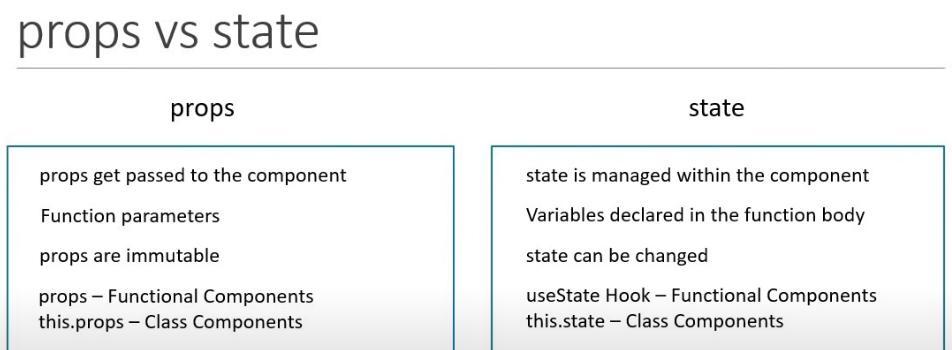

## prop Drilling:


# React Life Cycle Methods:


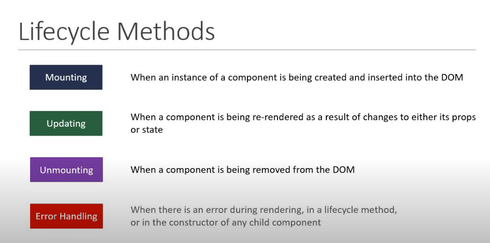

## Mounting Lifecycle Methods :

**1. constructor(props):**

- The constructor method is called when a component is initialized.
- It is used to initialize state and bind event handlers.
- It does not return a value.

**2. componentDidMount():**

- The componentDidMount method is called after the component has been mounted to the DOM.
- It is used to perform tasks that require access to the DOM or external APIs, such as fetching data.
- It does not return a value.

```
class MyComponent extends React.Component {
  componentDidMount() {
    console.log('Component has been mounted');
  }
}

```

**3. shouldComponentUpdate(nextProps, nextState):**

- The shouldComponentUpdate method is called before rendering when new props or state are received.
- It is used to optimize performance by controlling when the component should re-render.
- It returns a boolean value indicating whether the component should update or not.

```
class MyComponent extends React.Component {
  shouldComponentUpdate(nextProps, nextState) {
    if (this.props.data !== nextProps.data) {
      return true;
    }
    return false;
  }
}

```

**4. componentDidUpdate(prevProps, prevState, snapshot):**

- The `componentDidUpdate` method is called after the component has been updated and the changes have been applied to the DOM.
- It is used to perform side effects or additional updates in response to prop or state changes.
- It receives the previous props, previous state, and optional snapshot (from getSnapshotBeforeUpdate) as arguments.
- It does not return a value.

```
class MyComponent extends React.Component {
  componentDidUpdate(prevProps, prevState) {
    if (prevState.count !== this.state.count) {
      console.log('Count has changed');
    }
  }
}

```

**5. componentWillUnmount():**

- The componentWillUnmount method is called right before the component is unmounted and destroyed.
- It is used to perform cleanup tasks, such as removing event listeners or cancelling subscriptions.
- It does not return a value.

**6. getSnapshotBeforeUpdate**

**Purpose**: The getSnapshotBeforeUpdate method is called just before the component is re-rendered and updates are applied to the DOM. It provides an opportunity to capture some information or state from the DOM before it potentially changes.

**Return Value**: The getSnapshotBeforeUpdate method should return a value or null. The value returned from this method will be passed as the third parameter to the componentDidUpdate method.

**Usage**: getSnapshotBeforeUpdate is often used in combination with componentDidUpdate to handle scenarios where you need to perform operations that rely on the previous state or DOM state, such as preserving scroll positions or animating transitions.

- **The useEffect hook can be used with the useLayoutEffect variant to access the previous DOM state before updates are applied.**

**6. getDerivedStateFromProps**

- Purpose: The getDerivedStateFromProps method is called before rendering when new props are received. It provides an opportunity to update the state of the component based on the changes in props. It should return an object to update the state, or null to indicate no state update is necessary.
- Arguments: It receives two arguments: props and state. props represents the new props that the component is receiving, and state represents the current state of the component.
- Return Value: The method should return an object that represents the updated state, or null if no state update is necessary.

**Usage:**

- Compare Props: Inside getDerivedStateFromProps, you can compare the current props (props) with the next props (nextProps). Based on the comparison, you can update the state of the component.
- Synchronization: getDerivedStateFromProps is commonly used to keep the component's state synchronized with the changes in props.

```
static getDerivedStateFromProps(nextProps, prevState) {
    // Compare the new props with the previous state
    if (nextProps.value !== prevState.value) {
      return { value: nextProps.value };
    }
    return null;
  }
```

## Updating Lifecycle methods:

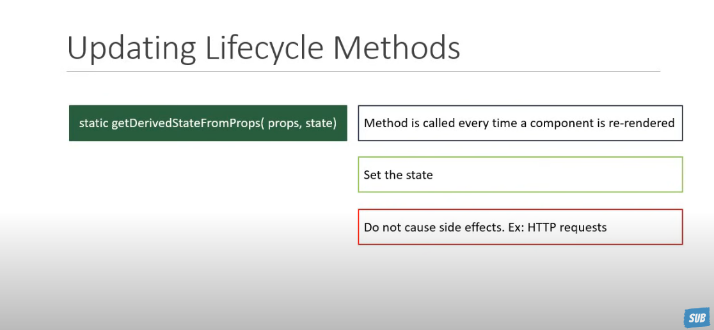

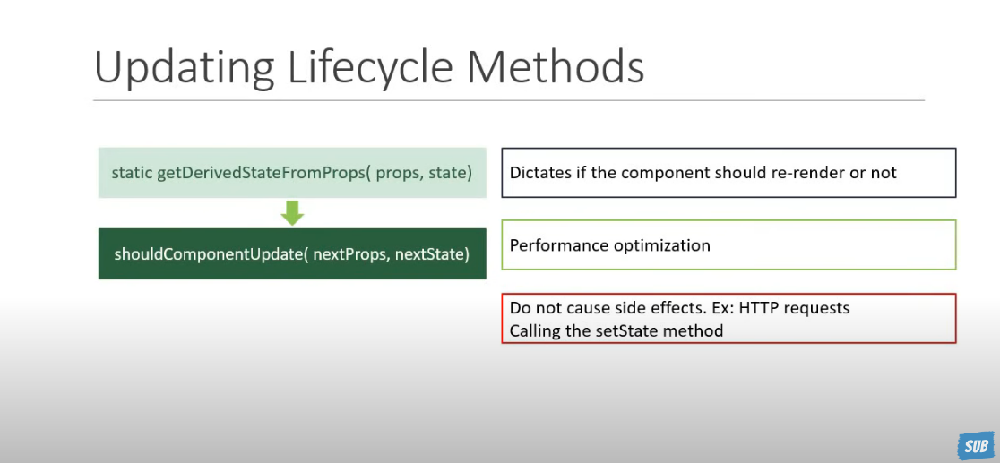

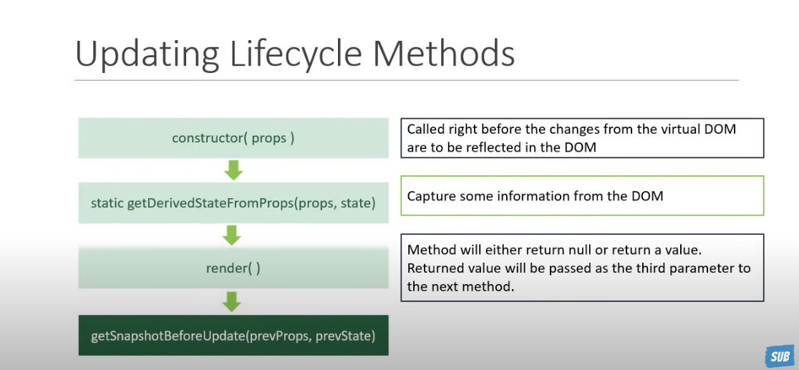

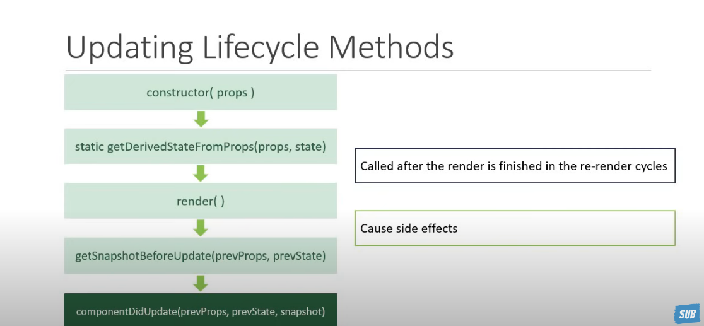

## **Flow Of Execution:**

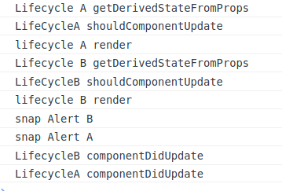

## Unmount Lifecycle Method:

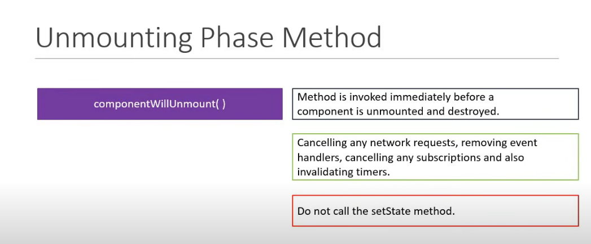

## Error Handling Phase:

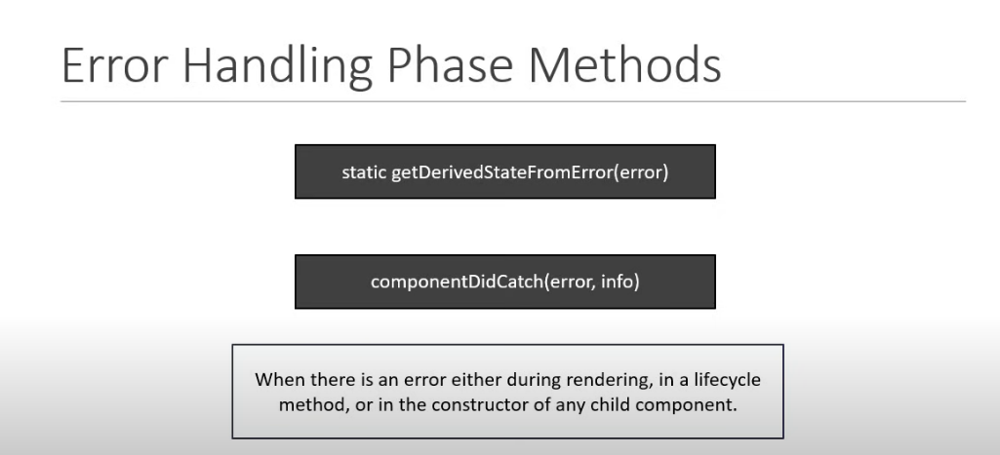

# Presentational and Container Components:

**Presentational components**:

- mainly concerned with how things look.
- Mainly receives data and callbacks exclusively via props.

```
// presentational component
const Users = props =>
	(<ul>
		{props.users.map(user =>
			(<li>{itr}</li> ))
		}
	</ul>)

```

**Container components**:

- Mainly concerned with how things work.
- Provide the data and behaviour to presentational or other container components.

**Finally at the conclusion we can conclude in simple terms that the presentational components are concerned with the look, container components are concerned with making things work.**

# Hooks:
- Hooks allow function components to have access to state and other React features. Because of this, class components are generally no longer needed.
- Hooks don't work inside the classes.

## Why Hooks?

- create components for complex scenarios such as data fetching and subscribing the events related code is not organized in one place.

- Ex: Data fetching : In componentDidMount and componentDidUpdate
- Ex: Event Listeners : In componentDidMount and componentwillUnmount

# Hooks Brief:

- useState state
- use Effect - side effects
- useContext - context API
- useReducer - reducers

## **useState Hook:**

- It is used when we have to changed the value of particular element or we can explictly pass the value of that element.
- Example:

```
const [count, setCount] = useState(`here-write-default-value` or `passed value`);
```

**Difference Between useState and setState**:

- The main difference is `setState` will merge the state and `useState` can not merge the state of an object.

- The useState hook lets you add state to functional components.
- In classes, the state is always an object.
- With the useState hook, the state doesn't have to be an object.
- The useState hook returns an array with 2 elements.
- The first element is the current value of the state, and the second element is a state setter function.
- New state value depends on the previous state value? You can pass a function to the setter function.
- When dealing with objects or arrays, always make sure to spread your state variable and then call the setter function

- **Example:**

- Lets take that we have one component in that we have to get the three values from the user like name, add and phone so in that there are two scenarios:

1. take three diff useState hooks for name , add and phone like below:

```
const [enteredTitle, setEnteredTitle] = useState('');
const [entered Amount, setEnteredAmount] = useState('');
const [enteredDate, setEnteredDate] useState('');
```

2. Another is take one useState and pass one object with these three name and intial value:

```
const [userInput, setUserInput] = useState({
    enteredTitle:"",
    enteredAmount:"",
    enteredDate: ""
});

```

- **But by doing this we have to give all these three property in our each handler other wise hook will remove other property if we dont define in our component see both format below:**

1. below code will remove other property like amount and date

```
const titleChangeHandler = (event) => { =
  setUserInput({
      enteredTitle: event.target.value,
  })
};
```

2.

```
const titleChangeHandler = (event) => { =
  setUserInput({
      ...STATENAME,
      enteredTitle: event.target.value,
  })
};
```

## how We can pass data from child to parent:

- for that first we create function in our parent component which will accept the data that we pass from child and accept in parent and In parent where we have define the child so in that component we can pass that function as props and named that props as something like event name like **onGetData** and after that we can access that particular on event in our child component's change handler like **props.onGetData(data)** .

- Example:

**Child component**:

```
props.onSaveExpenseData(data);
```

**parentComponent**:

```
const saveExpenseDataHandler = (data) => {
    const expenseData = { ...data, id: Math.random().toString() };
    console.log(expenseData);
  };
  return (
    <div className="new-expense">
      <FormHandle onSaveExpenseData={saveExpenseDataHandler} />
    </div>
  );
```

# useEffect:

- The Effect Hook lets you perform side effects in functional components
- It is a close replacement for **componentDidMount**, **componentDidUpdate** and **componentWillUnmount**.
- The Dependency array implements the **componentDidMount** lifecycle methods. and if any dependencies are passed to that array then that dependency will implements **componentDidUpdate** method props or state variables.
- we can use directly `useEffect()` and in that we can define the side effects or any change that is happen in web app.
- The useEffect hook is designed to work with both client-side and server-side rendering.

```
useEffect(setup, dependencies(we pass one array called dependency array)?)
```

- **setup**: The function with your Effect’s logic. Your setup function may also optionally return a cleanup function. When your component is first added to the DOM, React will run your setup function.

- **cleanup function:** It is a function of the useEffect hook that allows us to stop side effects that no longer need to be executed before our component is unmounted.

```
useEffect(()=>{}, [dependency array- this contain state on which the effect will perform, if this is blank then effect only render intially and giving any state it render effect on that particular state change only] )
```

## cleanup function:

```
  const mouseEvent = (e) => {
    console.log("MouseEvent Called"); // here the event called after the component is removed so to avoid this we have to use cleanup function
    setcordX(e.clientX);
    setcordY(e.clientY);
  };

  useEffect(() => {
    console.log("cord event");
    window.addEventListener("mousemove", mouseEvent);

    return () => {
      console.log("event removed");
      window.removeEventListener("mousemove", mouseEvent); // called cleanup function
    };
  }, []);
```

## for data fetch go through below code:

```

import React, { useEffect, useState } from "react";
import axios from "axios";

function DataFetch() {
  const [data, setData] = useState({});
  const [id, setId] = useState(1);
  const [btnId, setBtnId] = useState(1);

  useEffect(() => {
    axios
      .get(`https://dummyjson.com/products/${btnId}`)
      .then((res) => {
        console.log(res);
        setData(res.data);
      })
      .catch((err) => console.log(err));
  }, [btnId]);

  const handleClick = () => {
    setBtnId(id);
  };

  return (
    <div>
      <input type="text" value={id} onChange={(e) => setId(e.target.value)} />
      <button onClick={handleClick}>DataFetch</button>
      <div>{data.title}</div>
      
    </div>
  );
}

export default DataFetch;

```

# useContext:

- **Context provides a way to pass data through the component tree without having to pass props down manually at every level.**

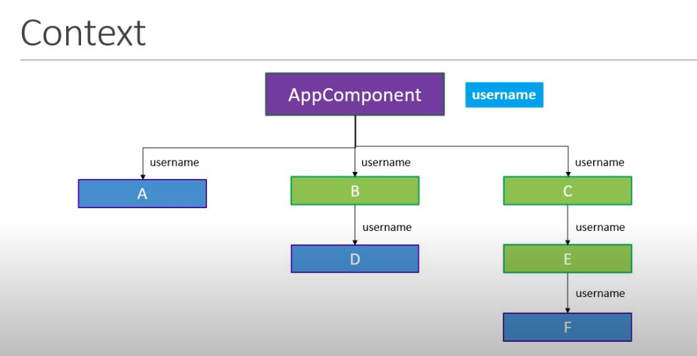

- Creating context:

```
`App.js`:

export const UserContext =  React.createContext()
export const ChannelContext =  React.createContext()

In return

  <UserContext.Provider value ={"Gunjan"}>
    <ChannelContext.Provider value ={"Pluto"}>
      <ChildChildComponent/>
    </ChannelContext.Provider>
  </UserContext.Provider>

In Child Component where we have to use this value:

  <UserContext.Consumer>
    {(name) => {
      return <>My name is {name}</>;
    }}
  </UserContext.Consumer>

```

## for Functional component:

```
In App.jsx

//step 1
export const UserContext = createContext();
// 2 wrap with provider
// 3 pass value to provider
// 4 consumer -- Component where we have to use for eg: In Child component write below code
const user = useContext(UserContext);

return (
<>
// 3 pass value to provider
<UserContext.Provider value={data}>
	<Parent />
</UserContext.Provider>
<>
)
```

## Other way useContext hook:

- In child component first import the context which are created in main component.

```
const user = useContext(context_name)
```

- And after this we can use directly user.

# useReducer:

- useReducer is a hook that is used for state management
- It is an alternative to useState
- useReducer is a hook that is used for state management in React
- useReducer is related to reducer functions
- useState is built using useReducer

```
const [state, dispatch] = useReducer(reducer, initialArg, init);
```

- Accepts a reducer of type `(state, action) => newState` and returns the current state paired with a dispatch method.
- **Lazy initialization**
- You can also create the initial state lazily. To do this, you can pass an **init** function as the third argument. The initial state will be set to **init(initialArg)**.

```
import React, { useReducer } from "react";

// Reducer function
const reducer = (state, action) => {
  switch (action.type) {
    case "INCREMENT":
      return { count: state.count + 1 };
    case "DECREMENT":
      return { count: state.count - 1 };
    default:
      return state;
  }
};

const Counter = () => {
  // Initial state
  const initialState = { count: 0 };

  // useReducer hook
  const [state, dispatch] = useReducer(reducer, initialState);

  return (
    <div style={{ textAlign: "center", marginTop: "50px" }}>
      <h2>Counter: {state.count}</h2>
      <button onClick={() => dispatch({ type: "DECREMENT" })}>-</button>
      <button onClick={() => dispatch({ type: "INCREMENT" })}>+</button>
    </div>
  );
};

export default Counter;

```

## useReducer with useContext:

- if we want to pass a global state to particular child component which are in nesting so we can use useReducer with useContext.

- steps:

1. first define reducer in the main component
2. Then create context in the main component
3. and then pass object in the contextprovider which has state and dispatch method.
4. And in child component import context and useContext hook and use that state object property using `.`.

## What's the difference?

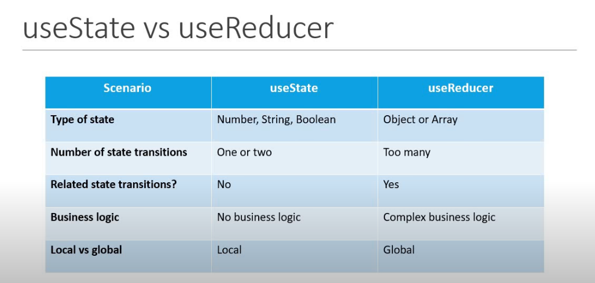

## useMemo:

- it will take the function which cached the values return by that function not cached whole function
- The useMemo hook takes two arguments: a function and a dependencies array. The function defines the value or result that you want to memoize, and the dependencies array specifies the values that the memoized result depends on. Whenever the dependencies change, the memoized value is recalculated; otherwise, the cached value is returned. it implements shoudComponentUpdate method.

```
const MyComponent = ({ a, b }) => {

  function addVal = (a,b) => a+b;
  const expensiveResult = useMemo(addVal, [a, b]); // cached two values
  return <div>{expensiveResult}</div>;
};
```

- Memoizing every value or result indiscriminately can lead to increased memory usage and potentially defeat the purpose of using useMemo.
- It's recommended to use useMemo when you have identified specific areas of your code that would benefit from performance optimizations.

# useCallback Hook:

- **useCallback** is a hook that will return a memoized version of the callback function that only changes if one of the dependencies has changed.
- this will cached the whole function by giving function definition in first argument.

- It used to compared with **`Object.is`**.

- means if we passed states in the child component then it will make unneccessary call for that state changes so to avoid that we can wrap particular state function in useCallback hook and give the state in dependency array so it will call only when thayt particular state changes.

```
const MyComponent = ({ a, b }) => {

  function addVal = (a,b) => a+b;
  const expensiveResult = useCallback(addVal, [a, b]); //cached whole function.
  return <div>{expensiveResult}</div>;
};
```

**Why**

- It is useful when passing callbacks to optimized child components that rely on reference equality to prevent unnecessary renders.

**`useCallback(fn, deps) is equivalent to useMemo(() => fn, deps).`**

# useCallback Vs useMemo:

```
const MyComponent = ({ a, b }) => {

  function addVal = (a,b) => a+b;
  const expensiveResult = useMemo(addVal, [a, b]); // cached two values 
  const expensiveResult = useCallback(addVal, [a, b]); // cached whole addVal
  return <div>{expensiveResult}</div>;
};
```
- we can use useMemo as useCallback but we cannot use useCallback as useMemo.see below:
```
const expensiveResult = useCallback(addVal, [a, b]); same as
const expensiveResult = useMemo(()=> addVal, [a, b]);
```

# useRef:

```
const ref = useRef(initialValue)
```

- Lets take one scenario that if we reload our page then our input field is targeted so how to achieve this using useRef hook lets look into it.
- useRef() only returns one item. It returns an Object called `current`.
- Changing a ref does not trigger a re-render. This means refs are perfect for storing information that doesn’t affect the visual output of your component.
- so **refs are not appropriate for storing information you want to display on the screen**.
- When we initialize useRef we set the initial value: useRef(0).
- It's like doing this: `const count = {current: 0}`. We can access the count by using count.current.
- It can be used to access a DOM element directly.
- In React, we can add a ref attribute to an element to access it directly in the DOM.

# forwardRef:

- forwardRef lets your component expose a DOM node to parent component with a ref.
- `const SomeComponent = forwardRef(render)`.

**Parameters**

- **render**: The render function for your component. React calls this function with the props and ref that your component received from its parent. The JSX you return will be the output of your component.

**Returns**

- forwardRef returns a React component that you can render in JSX. Unlike React components defined as plain functions, a component returned by forwardRef is also able to receive a ref prop.

# difference between useState and useRef hooks?

- Updating a reference created by useRef doesn't trigger re-rendering, while updating the state (setState) makes the component re-render;
- useRef returns an object with a current property holding the actual value. In contrast, useState returns an array with two elements.
- useRef‘s current property is mutable, but useState‘s state variable is not.
- The reference update is synchronous (the updated reference value is available right away), while the state update is asynchronous (the state variable is updated after re-rendering).

# useLayoutEffect:

- useLayoutEffect is a version of useEffect that fires before the browser repaints the screen.
- it runs synchronously immediately after the DOM has been updated and before the browser has a chance to paint.
- This means it blocks visual updates, and the user may experience a delay in seeing the updated content.

```
useLayoutEffect(setup, dependencies?)
```

- Measuring layout before the browser repaints the screen.
- This could be useful for animations, measuring element dimensions, or manipulating the DOM in ways that affect visual layout.
- It's important to note that using **useLayoutEffect** can potentially impact performance if not used carefully. Since it runs synchronously and can block visual updates, it may cause delays in rendering.

### Does useLayoutEffect will sutable for SSR?

- No, the useLayoutEffect hook is not suitable for server-side rendering (SSR) because it runs synchronously and can potentially block the rendering process.

- During server-side rendering, the component is rendered on the server before sending the initial HTML markup to the client. Since useLayoutEffect runs synchronously and interacts with the **Real DOM**, it would cause mismatches between the server-rendered HTML and the client-side rendered content. This can lead to hydration errors or other issues.

# useDebugValue

- useDebugValue is a React Hook that lets you add a label to a custom Hook in React DevTools.
- it is used when we have created custom hook and if we try to open devtool in chrome so it will not show that what value that hook contain so in that case if we have implemented the state in that custom hook and we provide that state value in useDebugValue hook so it will show that custome hook value in devtool.
- it only useful in custom hook.
- not use in any app component.
- useDebugValue does not return anything.

```
useDebugValue(value, format?)
```

- the use of format is like if we provide any single value and if that value will come from one function which can take more time then it will so in that case it will slow our custom hook so for that we provide that slow function as second value which take our val as argument and return that function with passing that value like below.

```
useDebugValue(value, v => slowFun(v));
```

# useDeferredValue

- useDeferredValue is a React Hook that lets you defer updating a part of the UI.

```
const deferredValue = useDeferredValue(value)
```

- During the initial render, the returned deferred value will be the same as the value you provided. During updates, React will first attempt a re-render with the old value (so it will return the old value), and then try another re-render in background with the new value (so it will return the updated value).

# useId

- useId is a React Hook for generating unique IDs that can be passed to accessibility attributes.

```
const id = useId()
```

- Generating unique IDs for accessibility attributes
- Generating IDs for several related elements
- Specifying a shared prefix for all generated IDs

# useImperativeHandle:

- useImperativeHandle is a React Hook that lets you customize the handle exposed as a ref.

```
useImperativeHandle(ref, createHandle, dependencies?)
```
- useImperativeHandle returns undefined.
- It is used to handle multiple ref in the component where we have define that refs.
- Example:
- for example i had one modal and in that three buttons and i want to focus that buttons from the parent component which has buttons so in that case we can create one ref and take modal ref in that ref like `const modalRef = useRef()` and in modal compoment `<Modal ref={modalRef} >` and now in this modal component we can access this ref and create the imperativeHandle hook which takes ref, a callback function which return object which has methods for three refs of that modal element for focus.and now in parent we can access this by giving this () => modalRef.current.method() to onclick.   

# useInsertionEffect

- it is a version of useEffect that fires before any DOM mutations.

```
useInsertionEffect(setup=The function with your Effect’s logic, dependencies?)
```

# useTransition:

- useTransition is a React Hook that lets you update the state without blocking the UI.

```
const [isPending, startTransition] = useTransition()
```

- useTransition does not take any parameters.
- useTransition returns an array with exactly two items:
- The isPending flag that tells you whether there is a pending transition.
- The startTransition function that lets you mark a state update as a transition.

```
  function selectTab(nextTab) {
    startTransition(() => {
      setTab(nextTab);
    });
  }
```

**Usage**

- Marking a state update as a non-blocking transition
- Updating the parent component in a transition
- Displaying a pending visual state during the transition
- Preventing unwanted loading indicators
- Building a Suspense-enabled router

# Custom Hooks:

- A custom Hook is basically a JavaScript function whose name starts with "use".
- A custom hook can also call other Hooks if required.
- For example if we have created one component and that component's functionality will used by other components also so it is not good practice to copy one component code write repeatedly into another component so to avoid this kind of problem we will create our custome hook and use that hook in another component.

**Why?**

- Share logic from one component to another components.
- Alternative to HOCs and Render Props
- logic abstarction and props.

## Example:

```
import { useEffect } from "react";

function useDocumentTitle(count) {
  useEffect(() => {
    document.title = `Count ${count}`;
  }, [count]);
  // console.log("hook called ");
}

export default useDocumentTitle;

```

- In our component when we are using custom hook.

```
const [count, setCount] = useState(0);

useDocumentTitle(count);
```

# useLocation Hook:

- It is basically used to get all the data that were passed with routes .
- when we locate useLocation hook on the particular component it will give us one object which has hash, key, pathname, search and state parameter which has passed with url.

## How to use:

- `useLocation` can be imported from `react-router-dom`
- if we want these parameter data in what ever component so in that component we can use this hook.
- In case of state we can pass state in our link and use that data using useLocation where ever we want.

# Extra Interview Question:

## 1. What is reconciliation in React js

- Reconciliation is the process by which React updates the user interface to reflect changes in the underlying component tree.
- When a component's state or props change, React performs reconciliation to determine the minimal set of changes needed to update the DOM efficiently.

**Process of reconciliation:**

- **Component Render**:
- **Reconciliation Algorithm**: React uses a diffing algorithm during reconciliation to compare the previous virtual DOM with the new virtual DOM and identify the differences or updates required.
- **Element Diffing**: React performs an element-by-element comparison between the previous and new virtual DOM.
- **Component Update**: When React encounters components with the same type, it updates the existing component rather than unmounting and replacing it.
- **Reconciliation Strategies**: React employs various strategies to optimize reconciliation.
- **DOM Update**:Once React determines the minimal set of changes required, it updates the actual DOM accordingly.

## 2. What is Portal?

- Portal is a recommended way to render children into a DOM node that exists outside the DOM hierarchy of the parent component.

```
ReactDOM.createPortal(child, container);
```

- The first argument is any render-able React child, such as an element, string, or fragment. The second argument is a DOM element.

**Usage**

- Portals are useful in situations where you need to render a component's content at a different DOM location, such as rendering modals, tooltips, or overlays that need to appear on top of other elements in the DOM hierarchy.
- To create a portal in React, you can use the ReactDOM.createPortal() method.

## 3. How to optimize React js app

- Use Production Build:
- Code Splitting:
- Memoization: Utilize React's memo or PureComponent to prevent unnecessary re-renders of components that haven't changed their props.
- Lazy Loading: Lazily load components or modules that are not immediately required.
- Server-Side Rendering (SSR): Consider server-side rendering for improved initial load times and search engine optimization (SEO).

## What is super, constructor , render function in Reactjs?

**1. super:**

- super is used to call the constructor of the parent class when defining a subclass. In React components, it is typically used in the constructor to initialize the parent class and bind the subclass instance.
- When extending a class component, you need to call super(props) in the constructor before accessing this.props.

**2. constructor:**

- The constructor is a special method used for initializing the state and binding event handlers in a React component. It is invoked when a new instance of the component is created.

**3. render:**

- The render function is a mandatory method in React class components. It returns the JSX (JavaScript XML) that describes the structure and content of the component's rendered output.

```
ReactDOM.render(element, container, [callback])
```

## Differences between react and angular:

- Angular is a framework, while React is a library.
- React built using JSX where Angular built using Typescript.
- React uses virtual dom where angular using real dom.

## What are the types of virtual dom?

- There are two types of virtual dom:
- The first one contains the updated virtual DOM, and the other is a pre-updated version of the updated virtual DOM.

## What is `React. StrictMode` mode?

- React. StrictMode is a tool that highlights potential issues in a programme.
- it does not render any visible elements in the DOM in development mode, but it enables checks and gives warnings.

## What is secure routes?

## What are synthetic events in React?

- Synthetic events are the objects which act as a cross-browser wrapper around the browser’s native event including stopPropagation() and preventDefault(),.
- They combine the behavior of different browsers into one API.
- This is done to make sure that the events show consistent properties across different browsers.

## What do you understand by refs in React?

- Refs is the short hand for References in React.
- It is an attribute which helps to store a reference to a particular React element or component.

## List some of the cases when you should use Refs.

- When you need to manage focus, select text
- Integrate with third-party DOM libraries

## How do you modularize code in React?

- We can modularize code by using the export and import properties.

## What is React Fiber?

- Fiber is the new reconciliation engine or reimplementation of core algorithm in React v16. The goal of React Fiber is to increase its suitability for areas like animation, layout, gestures, ability to pause, abort, or reuse work and assign priority to different types of updates; and new concurrency primitives.

- Its headline feature is incremental rendering: the ability to split rendering work into chunks and spread it out over multiple frames.
  Its main goals are:

- Ability to split interruptible work in chunks.
- Ability to prioritize, rebase and reuse work in progress.
- Ability to yield back and forth between parents and children to support layout in React.
- Ability to return multiple elements from render().
- Better support for error boundaries.

## What is the difference between createElement and cloneElement?

- JSX elements will be transpiled to React.createElement() functions to create React elements which are going to be used for the object representation of UI. - Whereas cloneElement is used to clone an element and pass it new props.

# Lazy:

## Is lazy function supports named exports?

No, currently React.lazy function supports default exports only. If you would like to import modules which are named exports, you can create an intermediate module that reexports it as the default. It also ensures that tree shaking keeps working and don’t pull unused components.

```
// IntermediateComponent.js
export { SomeComponent as default } from "./MoreComponents.js";
```

```
import React, { lazy } from "react";
const SomeComponent = lazy(() => import("./IntermediateComponent.js"));

in render :

<Suspense fallback={<Loading />}>
  <h2>Preview</h2>
  <MarkdownPreview />
 </Suspense>
```

## Why React uses className over class attribute?

The attribute class is a keyword in JavaScript, and JSX is an extension of JavaScript. That's the principal reason why React uses className instead of class. Pass a string as the className prop.

## What is ReactDOMServer?

The ReactDOMServer object enables you to render components to static markup (typically used on node server). This object is mainly used for server-side rendering (SSR). The following methods can be used in both the server and browser environments:

- renderToString()
- renderToStaticMarkup()

## How events are different in React?

- Handling events in React elements has some syntactic differences:
- React event handlers are named using camelCase, rather than lowercase.
- With JSX you pass a function as the event handler, rather than a string.

--100 question

# memo:

- **arePropsEqual**: A function that accepts two arguments: the component’s previous props, and its new props. It should return true if the old and new props are equal: that is, if the component will render the same output and behave in the same way with the new props as with the old. Otherwise it should return false. Usually, you will not specify this function. By default, React will compare each prop with Object.is.
