# HTML

## What is HTML?

- HTML stands for Hyper Text Markup Language
- HTML is the standard markup language for Web pages. </br>
- HTML is Not Case Sensitive.

## Sequence of running apply style to particular element

- html file will be executed line by line so whatever style we applied at last that will apply.
- if inline is there then that style is only applied .
- internal and external will depend on the order we had given.

## Accessibility object model (AOM)

- As the browser parses the content received, it builds the document object model (DOM) and the CSS object model (CSSOM). It then also builds an accessibility tree.
- The AOM is like a semantic version of the DOM.
## Html 5 Elements:

- All Sementic Elements.

```
Color
Date
Datetime-local
Email
Time
Url
Range
Telephone
Number
Search
```

## What is a marquee in HTML?

Marquee is used for scrolling text on a web page. It scrolls the image or text up, down, left, or right automatically. To apply for a marquee, you have to use </marquee> tags.

## What is the difference between “display: none” and “visibility: hidden” when used as attributes to the HTML element?

The main difference between “display: none” and “visibility: hidden” is that the former removes the element from the document flow, while the latter simply hides it. Elements with “display: none” are not visible and do not take up any space on the page, while elements with “visibility: hidden” are not visible but still take up space.

## When to use scripts in the head and when to use scripts in the body?

Scripts can be placed in the <head> section of the HTML document or in the <body> section. Scripts that must be executed before the page is displayed, such as scripts that define variables or functions, should be placed in the <head> section. Scripts that must be executed after the page is displayed, such as scripts that manipulate the DOM, should be placed in the <body> section.

## Tags:

- The `<!DOCTYPE html>` declaration defines that this document is an HTML5 document
- The `<html>` element is the root element of an HTML page
- The `<head>` element contains meta information about the HTML page
- The `<title>` element specifies a title for the HTML page (which is shown in the browser's title bar or in the page's tab)
- The `<body>` element defines the document's body, and is a container for all the visible contents, such as headings, paragraphs, images, hyperlinks, tables lists, etc.
- The `<h1>` element defines a large heading
- The `<p>` element defines a paragraph

## What is an HTML Element?

- An HTML element is defined by a start tag, some content, and an end tag:
- The HTML element is everything from the start tag to the end tag.
- `<tagname>` Content goes here... `</tagname>`

## HTML Attributes

- All HTML elements can have attributes
- Attributes provide additional information about elements
- Attributes are always specified in the start tag
- Attributes usually come in name/value pairs like: name="value"

## URL:

- There are two ways to specify the URL in the src attribute:</br>

1. Absolute URL - Links to an external image that is hosted on another website. Example: src="https://www.w3schools.com/images/img_girl.jpg". </br> </br>
2. Relative URL - Links to an image that is hosted within the website. Example: src="/images/img_girl.jpg".

## Attributes:

- The lang attribute of the `<html>` tag declares the language of the Web page
- The title attribute defines some extra information about an element

## `meta` tag:

- `<meta name="viewport" content="width=device-width, initial-scale=1.0">`
- This gives the browser instructions on how to control the page's dimensions and scaling.
- The `width=device-width` part sets the width of the page to follow the screen-width of the device (which will vary depending on the device).
- The `initial-scale=1.0` part sets the initial zoom level when the page is first loaded by the browser.

## `<hr>` tag:

- The `<hr>` tag defines a thematic break in an HTML page, and is most often displayed as a horizontal rule.

## `<pre>` tag:

- The text inside a `<pre>` element is displayed in a fixed-width font (usually Courier), and it preserves both spaces and line breaks

* `<hr>`and `<br>` are not needed closing tag.

## HTML Formatting Elements:

<strong> - Important text </strong> </br>
<i> - Italic text </i></br>
<em> - Emphasized text </em></br>
<mark> - Marked text </mark></br>
<small> - Smaller text </small></br>
<del> - Deleted text </del></br>
<ins> - Inserted text </ins></br>
<sub> - Subscript text </sub></br>
<sup> - Superscript text </sup>

</br></br>

## HTML Quotation and Citation Elements:

- `<blockquote>`,`<q>`, `<abbr>`, `<address>`, `<cite>`, and `<bdo>` HTML elements.
  </br>

## `<cite>` tag:

- Defines the title of a creative work.

## `<bdo>` tag: Bi-Directional Override

- <bdo dir="rtl">This line will be written from right to left</bdo>

## Email links:

- `mailto` : directly link to ur email
- `<a href="mailto:nowhere@mozilla.org">Send email to nowhere</a>`

## Link bookmark:

- Use the id attribute (id="value") to define bookmarks in a page </br>
- Use the href attribute (href="#value") to link to the bookmark

- <p><a href="#C4">Jump to Chapter 4</a></p>
- <h2 id="C4">Chapter 4</h2>

## Image Floating:

- Use the CSS float property to let the image float to the right or to the left of a text.

## HTML `<map>` Tag:

- Example: </br>
- between map you can use area tag which define the area of particular image and you will add attribute on area tag: </br>

- A clickable area is defined using an `<area>` element. </br>
  -You must define the shape of the clickable area, and you can choose one of these values:
  </br>
- `rect` - defines a rectangular region
- `circle` - defines a circular region
- `poly` - defines a polygonal region
- `default` - defines the entire region

## `<picture>` tag:

- Resize the browser window to load different images.

## Background Image on a HTML element:

- `<p style="background-image: url('img_girl.jpg');">` </br>
- To avoid the background image from repeating itself, set the `background-repeat` property to `no-repeat`. </br>
- If you want the background image to cover the entire element, you can set the `background-size` property to `cover`. </br>
- Also, to make sure the entire element is always covered, set the `background-attachment` property to `fixed`. </br>

## Favicon:

- `<link rel="icon" type="image/x-icon" href="/images/favicon.ico">`.

## table properties:

- border: 1px solid black. </br>
- To avoid having double borders -> border-collapse: collapse. </br>
- With the `border-radius` property, the borders get rounded corners. </br>
- `border-style`: </br>
  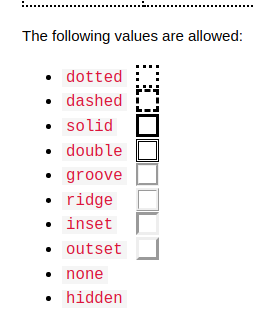

- `border-color: #96D4D4;` </br>
- To add a caption/title to a table, use the `<caption>` tag </br>
- The `<caption>` tag should be inserted immediately after the `<table>` tag. </br>
- To add `padding` only `above` the content, use the `padding-top` property. And the others sides with the `padding-bottom`, `padding-left`, and `padding-right` properties. </br>
- `HTML Table - Cell Spacing` we used `border-spacing: 20px` </br>
- To style every other table row element, use the `tr:nth-child(even)` selector like this.</br>
- Add the `border-bottom` property to all `tr` elements to get horizontal dividers.</br>
- Use the `:hover` selector on `tr` to `highlight` table rows on mouse over.</br>

## `<colgroup>`:

- The `<colgroup>` element is used to style specific columns of a table. </br>
- Each group is specified with a `<col>`element.</br>
- The span attribute specifies how many columns that get the style.The style attribute specifies the style to give the columns.
- `The <colgroup> tag must be a child of a <table> element and should be placed before any other table elements, like <thead>, <tr>, <td> etc., but after the <caption> element, if present.`

- `width` property
- `visibility` property
- `background` properties
- `border` properties
- You can hide columns with the `visibility: collapse` property.

## List:

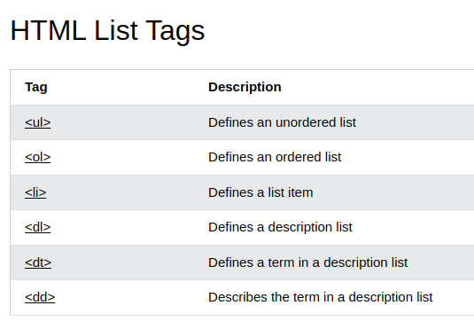</br>
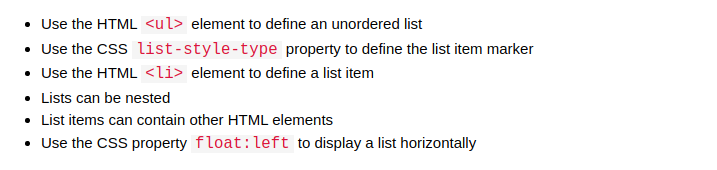</br>
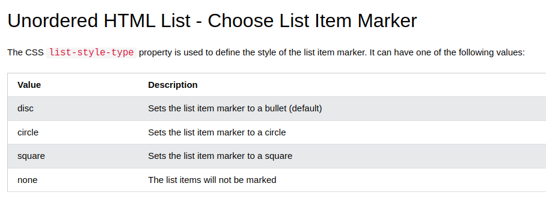

## Blocklevel elements:

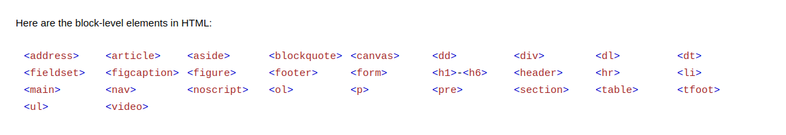

## Inline Elements:

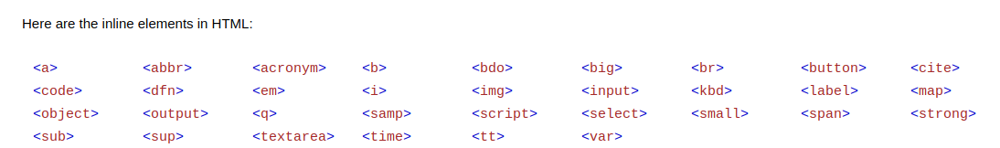

## class:

- Different elements can have same class and same element can have diff class name.

## id:

- The HTML id attribute is used to specify a unique id for an HTML element.You cannot have more than one element with the same id in an HTML document.

## HTML Iframes:

- An HTML iframe is used to display a web page within a web page.
- `<iframe src="url" title="description"></iframe>`.
  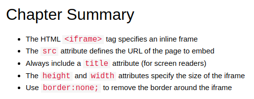

## Layout:

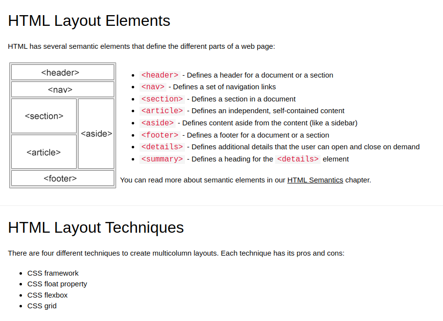

## HTML Responsive Web Design:

- Responsive web design is about creating web pages that look good on all devices! A responsive web design will automatically adjust for different screen sizes and viewports.

### What is Responsive Web Design?

- Responsive Web Design is about using HTML and CSS to automatically resize, hide, shrink, or enlarge, a website, to make it look good on all devices (desktops, tablets, and phones).

- To create a responsive website, add the following `<meta>` tag to all your web pages:
- Example: `<meta name="viewport" content="width=device-width, initial-scale=1.0">`

### Using the max-width Property:

- If the `max-width` property is set to 100%, the image will scale down if it has to, but never scale up to be larger than its original size.

### Responsive Text Size:

- The text size can be set with a "vw" unit, which means the "viewport width".
- `1vw = 1% of viewport width`.

### Media Queries:

- It is like an if condition that you apply on different devices screen sizes. you can set max-width for particular format and above that it will change it will change format of content.
  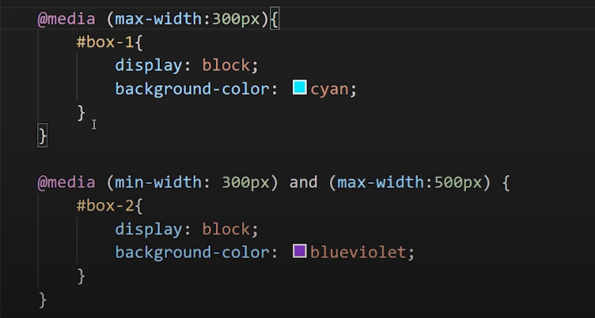

## Computercode:

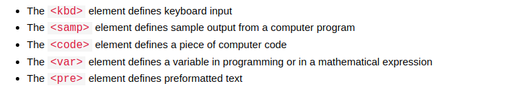

## HTML Semantic Elements:

- Semantic elements = elements with a meaning.</br>
- A semantic element clearly describes its meaning to both the browser and the developer.</br>
- Examples of non-semantic elements: `<div> and <span>`- Tells nothing about its content.</br>
- Examples of semantic elements: `<form>, <table>, and <article>` - Clearly defines its content.</br>

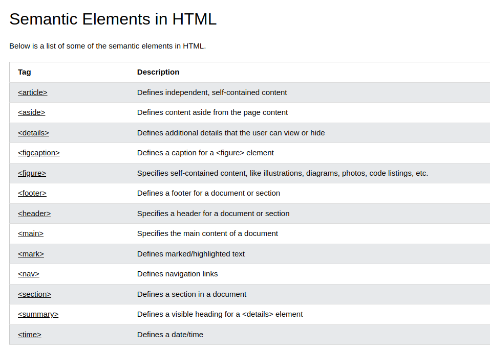

## Omitting `<html>` and `<body>`?

- Omitting `<body>` can produce errors in older browsers.
- Omitting `<html>` and `<body>` can also crash DOM and XML software.

## meta:

- The `initial-scale=1.0` part sets the initial zoom level when the page is first loaded by the browser.

## HTML Entities:

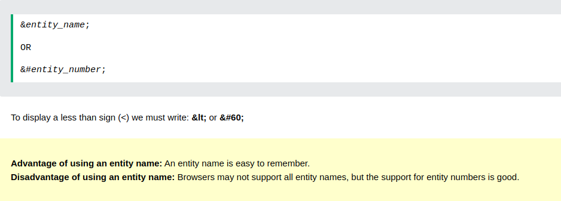

### nbsp:

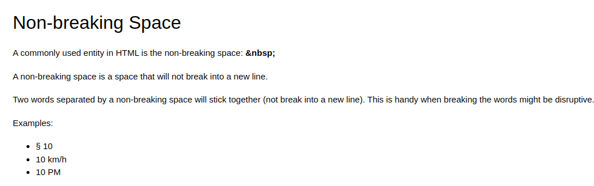

## Diacritical Marks:

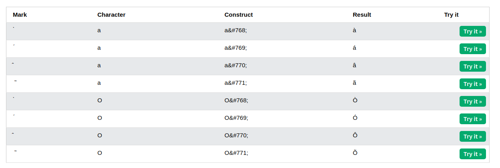

## Form:

### input element:

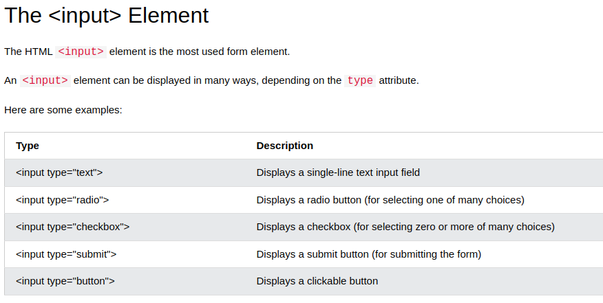

### label element:

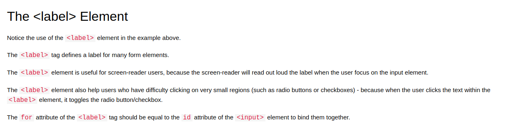

### The Name Attribute for `<input>` :

- Notice that each input field must have a name attribute to be submitted. If the name attribute is omitted, the value of the input field will not be sent at all.</br>
- The name attribute specifies the name of an `<input>` element. </br>
- The name attribute is used to reference elements in a JavaScript, or to reference form data after a form is submitted.

### The Action Attribute:

- If the `action` attribute is omitted from the form tag, then the action is set to the current page.

### The Target Attribute:

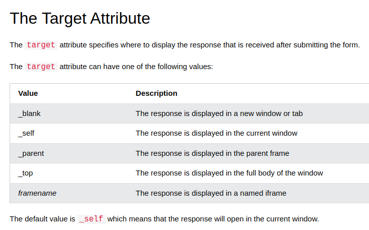

### The Method Attribute:

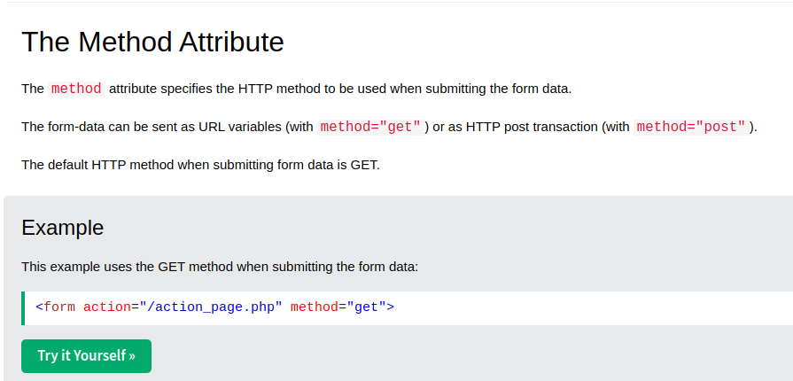

### The Autocomplete Attribute:

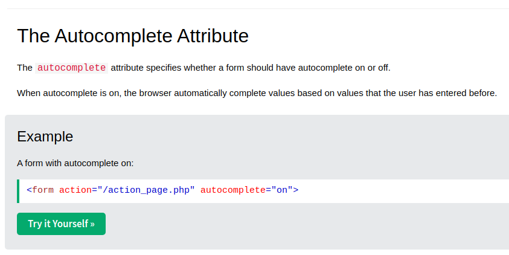 </br>

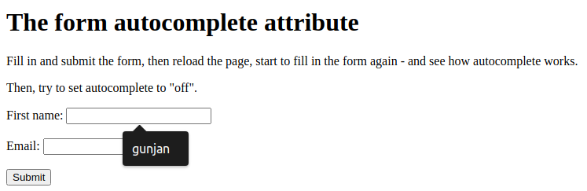

### The `<select>` Element:

- The `<select>` element defines a drop-down list.
- The `<option>` elements defines an option that can be selected.
- To define a pre-selected option, add the `selected` attribute to the `option`.
- Use the size attribute to specify the number of visible value.
- Use the `multiple` attribute to allow the user to select more than one value.

### The `<textarea>` Element

- The `<textarea>` element defines a multi-line input field (a text area):
- The rows attribute specifies the visible number of lines in a text area.
- The cols attribute specifies the visible width of a text area.
  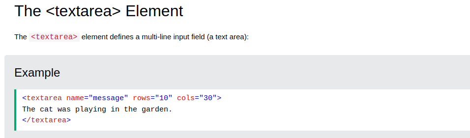

### The `<fieldset>` and `<legend>` Elements:

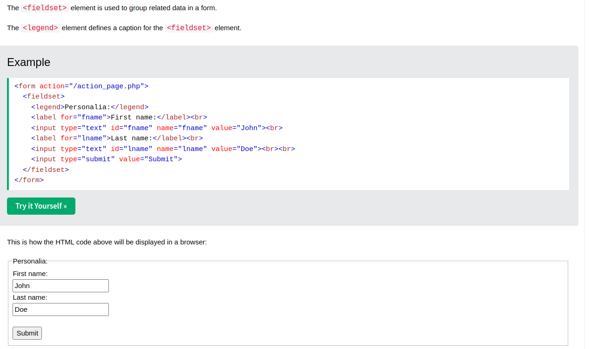

### The `datalist` element:

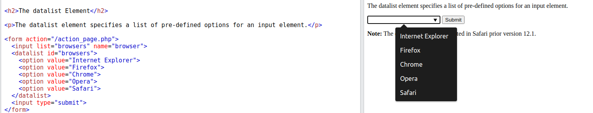

### The form elements:

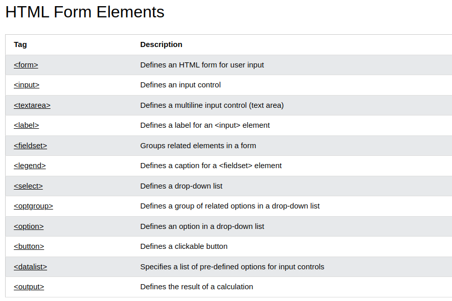

### The input types:

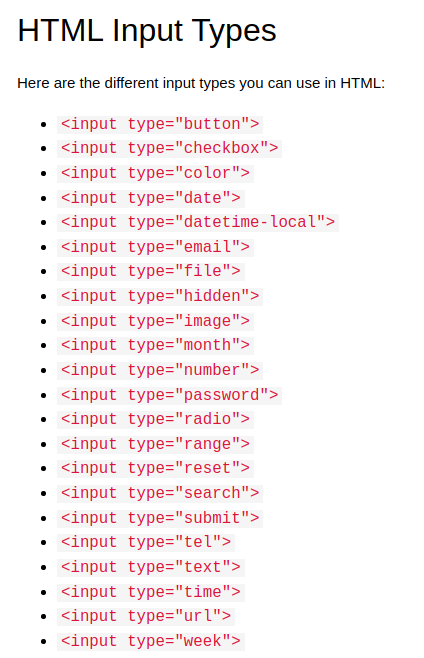

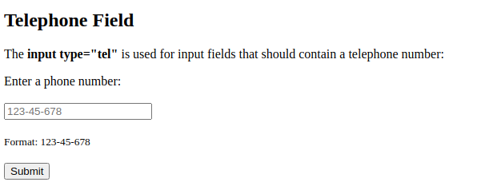

### The disabled attributes:

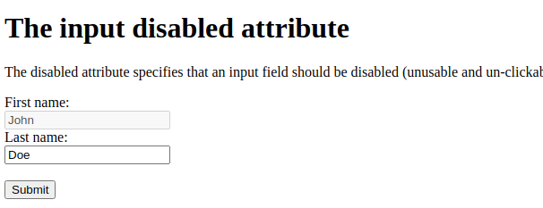

### The formaction Attribute:

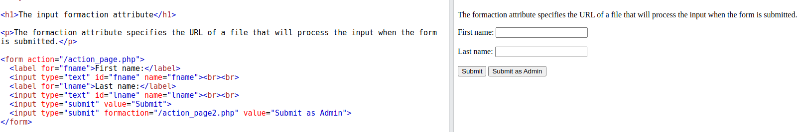

###
