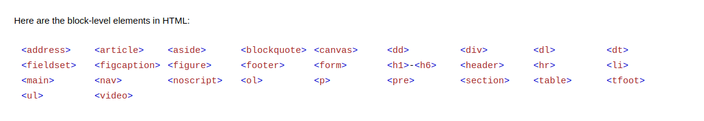
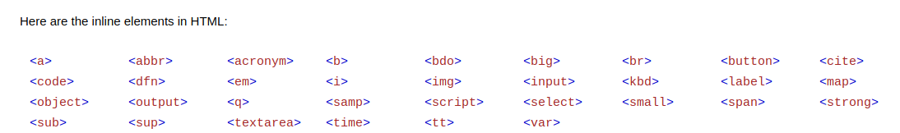
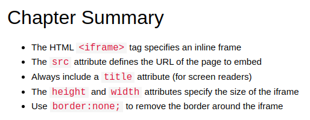
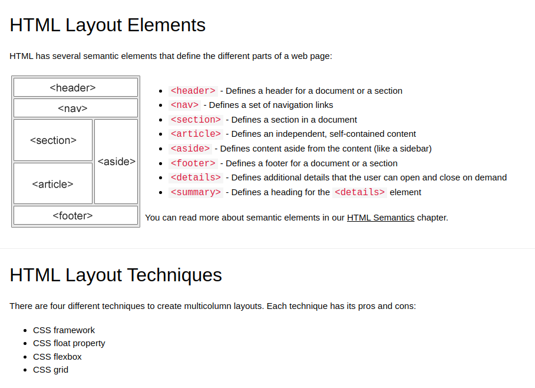
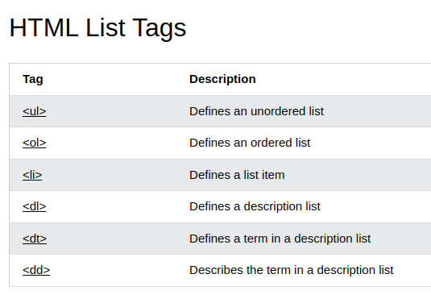
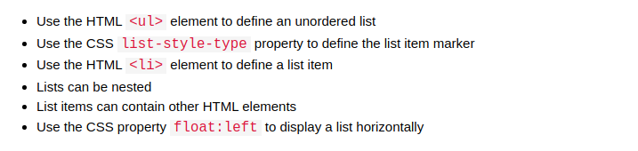
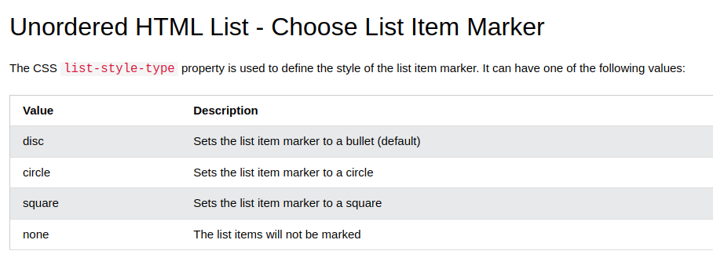

# HTML

## What is HTML?

- HTML stands for Hyper Text Markup Language
- HTML is the standard markup language for Web pages. </br>
- HTML is Not Case Sensitive.

## Accessibility object model (AOM)

- As the browser parses the content received, it builds the document object model (DOM) and the CSS object model (CSSOM). It then also builds an accessibility tree.
- The AOM is like a semantic version of the DOM.

## HTML Semantic Elements:

- Semantic elements = elements with a meaning.</br>
- A semantic element clearly describes its meaning to both the browser and the developer.</br>

```
header
section
footer
nav
```

## Html 5 Features:

- All Sementic Elements.
- Audio and Video Support.
- Canvas Elements.
- Local Storage
- Responsive Images using **srcset** & **sizes** attribute in img tag. For example:

```
srcset=" small.jpg 240w, medium.jpg 300w, large.jpg 720w
sizes=" (min-width: 960px) 720px, 100vw "
```

## Tags:

- The `<!DOCTYPE html>` declaration defines that this document is an HTML5 document
- The `<html>` element is the root element of an HTML page
- The `<head>` element contains meta information about the HTML page
- The `<title>` element specifies a title for the HTML page (which is shown in the browser's title bar or in the page's tab)
- The `<body>` element defines the document's body, and is a container for all the visible contents, such as headings, paragraphs, images, hyperlinks, tables lists, etc.

## What is a marquee in HTML?

Marquee is used for scrolling text on a web page. It scrolls the image or text up, down, left, or right automatically. To apply for a marquee, you have to use </marquee> tags.

## What is the difference between “display: none” and “visibility: hidden” when used as attributes to the HTML element?

“display: none” : It removes the element from the document flow & do not take up any space on the page
“visibility: hidden” : It simply hides element & It take up space.

# What is difference between opacity 0 vs visibility hidden?


# What is the difference between readonly and disabled inputs (behavior + form submission)?

- Both readonly and disabled prevent a user from editing an input's value, but they behave quite differently beyond that.
- A readonly input is still focusable, can be tabbed to, and most importantly its value is included when the form is submitted.
- A disabled input is completely inert as it cannot be focused, cannot be interacted with in any way, and its value is entirely excluded from form submission.

## When to use scripts in the head and when to use scripts in the body?

- Scripts can be placed in the `<head>` section of the HTML document or in the `<body>` section.
- Scripts that must be executed before the page is displayed, such as scripts that define variables or functions, should be placed in the `<head>` section.
- Scripts that must be executed after the page is displayed, such as scripts that manipulate the DOM, should be placed in the `<body>` section.

## URL:

- There are two ways to specify the URL in the src attribute:</br>

1. Absolute URL - Links to an external image that is hosted on another website. Example: src="https://www.w3schools.com/images/img_girl.jpg". </br> </br>
2. Relative URL - Links to an image that is hosted within the website. Example: src="/images/img_girl.jpg".

## `meta` tag:

- `<meta name="viewport" content="width=device-width, initial-scale=1.0">`
- This gives the browser instructions on how to control the page's dimensions and scaling.
- The `width=device-width` part sets the width of the page to follow the screen-width of the device (which will vary depending on the device).
- The `initial-scale=1.0` part sets the initial zoom level when the page is first loaded by the browser.

## `<pre>` tag:

- The text inside a `<pre>` element is displayed in a fixed-width font (usually Courier), and it preserves both spaces and line breaks

* `<hr>`and `<br>` are not needed closing tag.

## HTML Formatting Elements:

`<strong>`: <strong> - Important text </strong> </br>
`<i>`: <i> - Italic text </i></br>
`<em>`: <em> - Emphasized text </em></br>
`<mark>`: <mark> - Marked text </mark></br>
`<small>`: <small> - Smaller text </small></br>
`<del>`: <del> - Deleted text </del></br>
`<ins>`: <ins> - Inserted text </ins></br>
`<sub>`: <sub> - Subscript text </sub></br>
`<sup>`: <sup> - Superscript text </sup>

</br></br>

## HTML Quotation and Citation Elements:

- `<blockquote>`,`<q>`, `<abbr>`, `<address>`, `<cite>`, and `<bdo>` HTML elements.
  </br>

## `<bdo>` tag: Bi-Directional Override

- <bdo dir="rtl">This line will be written from right to left</bdo>

## Email links:

- `mailto` : directly link to ur email
- `<a href="mailto:nowhere@mozilla.org">Send email to nowhere</a>`


## Background Image on a HTML element:

- `<p style="background-image: url('img_girl.jpg');">` </br>
- To avoid the background image from repeating itself, set the `background-repeat` property to `no-repeat`. </br>
- If you want the background image to cover the entire element, you can set the `background-size` property to `cover`. </br>
- Also, to make sure the entire element is always covered, set the `background-attachment` property to `fixed`. </br>

## Favicon:

- `<link rel="icon" type="image/x-icon" href="/images/favicon.ico">`.

## Blocklevel elements:

```
div, p, nav, video, section, table, h1-h6, order, unorder, description lists.
```



## Inline Elements:

```
a-anchor, input, img, label, button, textarea, sub, sup, strong.
```



## id:

- The HTML id attribute is used to specify a unique id for an HTML element.You cannot have more than one element with the same id in an HTML document.

## HTML Iframes:

- An HTML iframe is used to display a web page within a web page.
- `<iframe src="url" title="description"></iframe>`.
  

## Layout:



### Using the max-width Property:

- If the `max-width` property is set to 100%, the image will scale down if it has to, but never scale up to be larger than its original size.

### Responsive Text Size:

- The text size can be set with a "vw" unit, which means the "viewport width".
- `1vw = 1% of viewport width`.

### Media Queries:

- It is like an if condition that you apply on different devices screen sizes.
- you can set max-width for particular format and above that it will change it will change format of content.

```
@media (max-width: 300px) {
  #box-1{
    display: block;
    background-color: cyan;
  }
}
```

## Omitting `<html>` and `<body>`?

- Omitting `<body>` can produce errors in older browsers.
- Omitting `<html>` and `<body>` can also crash DOM and XML software.

## meta:

- The `initial-scale=1.0` part sets the initial zoom level when the page is first loaded by the browser.

## HTML Entities:

```
&entity_name;
OR
&#entity_number;
```

- Ex: **&lt,&copy**

### nbsp:

- non breaking space

## Form:

### label element:

- The `<label>` tag defines a label for many form elements.
- The `<label>` element is useful for screen-reader users, because the screen-reader will read out loud the label when the user focus on the input element.
- The `<label>` **_ element also help users who have difficulty clicking on very small regions (such as radio buttons or checkboxes) - because when the user clicks the text within the `<label>` element, it toggles the radio button/checkbox _**.
- The **for** attribute of the `<label>` tag should be equal to the **id** attribute of the `<input>` element to bind them together.

### The `name` Attribute for `<input>` :

- Notice that each input field must have a **name** attribute to be submitted. If the **name** attribute is omitted, the value of the input field will not be sent at all.</br>
- The name attribute specifies the name of an `<input>` element. </br>
- The name attribute is used to reference elements in a JavaScript, or to reference form data after a form is submitted.

### The Action Attribute:

- If the `action` attribute is omitted from the form tag, then the action is set to the current page.

### The Target Attribute:

`_blank`: The response is displayed in a new window or tab
`_self` : The response is displayed in the current window
`_parent`: The response is displayed in the parent frame
`_top`: The response is displayed in the full body of the window

### The Method Attribute:

- **get & post**

### The Autocomplete Attribute:

### The `<select>` Element:

- The `<select>` element defines a drop-down list.
- The `<option>` elements defines an option that can be selected.
- To define a pre-selected option, add the `selected` attribute to the `option`.
- Use the size attribute to specify the number of visible value.
- Use the `multiple` attribute to allow the user to select more than one value.

### The `<textarea>` Element

- The `<textarea>` element defines a multi-line input field (a text area):
- The rows attribute specifies the visible number of lines in a text area.
- The cols attribute specifies the visible width of a text area.

```
<textarea name="message" rows="10" cols="30">
  The cat was playing in the garden.
</textarea>
```

### The disabled attributes:

- make input field disabled.

## How can we create circle and square in html css using only one div?

```
<div class="shape"></div>

.shape {
  width: 100px;
  height: 100px;
  background-color: blue; /* color for the square */
  position: relative;
}

.shape::before {
  content: '';
  position: absolute;
  width: 100px; /* same width as the parent */
  height: 100px; /* same height as the parent */
  background-color: red; /* color for the circle */
  border-radius: 50%; /* makes it a circle */
  top: 0;
  left: 150px; /* adjust this value to move the circle */
}


```

- Local Storage - This helps in storing data that will be retained even though the user reopens the browser. It is stored for each webapp on different browsers.
- Session Storage - This is used for one session only. After the user closes the browser this gets deleted.

## List:

</br>
</br>

